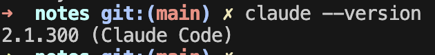
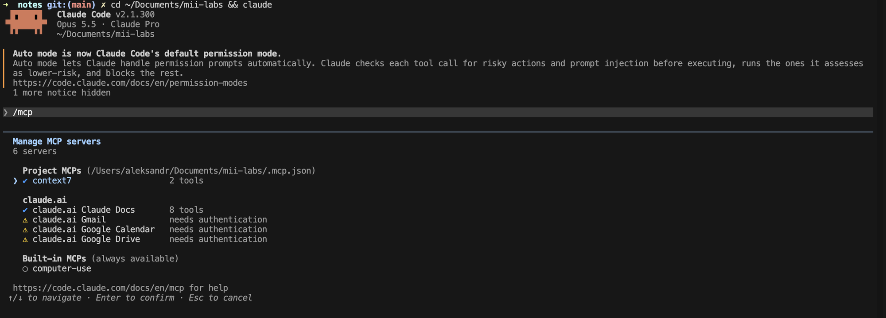
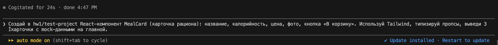
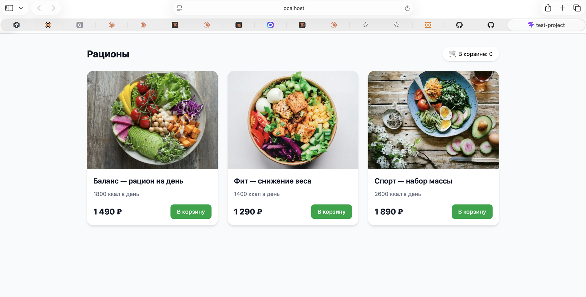
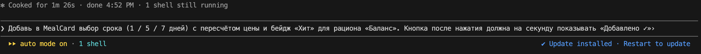
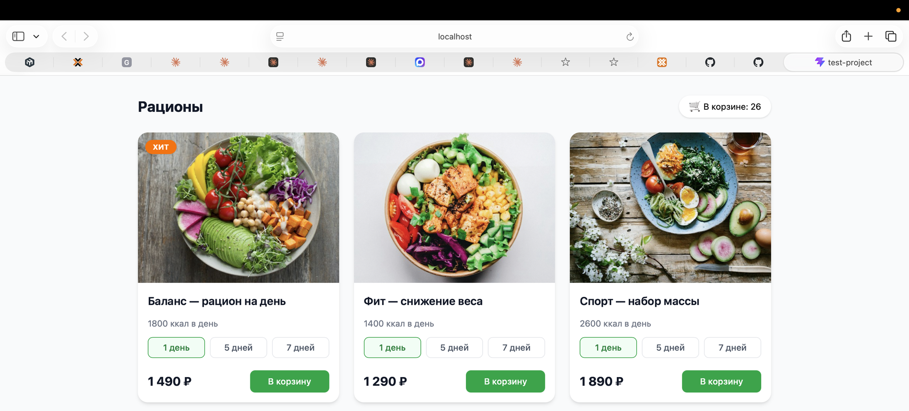

# ДЗ1. Сравнительный анализ и настройка AI-инструментов

## 1. Задача и требования

**Задача:** разработка MVP веб-приложения для заказа здорового питания (FoodTech). Пользователь выбирает готовый рацион на день или неделю, оплачивает заказ и оформляет доставку.

**Стек:** React + TypeScript + Vite + Tailwind CSS (фронтенд), Supabase (БД, авторизация), GitHub Actions (CI/CD).

| Требование | Значение | Что это значит для выбора инструмента |
|---|---|---|
| Сложность | средняя: несколько экранов, БД, авторизация, интеграции | агент должен справляться с многошаговыми задачами, а не только генерировать один экран |
| Доступ к локальным файлам | обязателен | проект ведётся в git-репозитории; агент должен работать с файлами, терминалом и тестами |
| Безопасность данных | приложение хранит персональные данные (имя, телефон, адрес) | код и секреты не должны храниться на сторонней платформе; нужен контроль над действиями агента |
| Бюджет | студенческий, до ~$20 в месяц | одна подписка или бесплатный инструмент |
| Интеграция в процесс | Git/GitHub, терминал, MCP | агент должен встраиваться в обычный процесс разработки, а не заменять его |

## 2. Анализ инструментов

Рассмотрены 4 инструмента: 2 Cloud-агента (Bolt.new, Lovable) и 2 CLI-агента (Claude Code, Gemini CLI). Полная таблица с обоснованием каждой оценки — в [comparison.md](comparison.md).

| Инструмент | Тип | Контекст | Скорость | Качество | Стоимость | Безопасность | Интеграция | **Итого** |
|---|---|:-:|:-:|:-:|:-:|:-:|:-:|:-:|
| Bolt.new | Cloud | 2 | 5 | 3 | 3 | 2 | 2 | **17** |
| Lovable | Cloud | 2 | 5 | 3 | 3 | 2 | 3 | **18** |
| Claude Code | CLI | 5 | 4 | 5 | 3 | 4 | 5 | **26** |
| Gemini CLI | CLI | 4 | 4 | 4 | 5 | 3 | 4 | **24** |

**Главный вывод:** Cloud-агенты выигрывают по скорости старта, но проигрывают по работе с контекстом, безопасности и интеграции. Для проекта, который ведётся в локальном репозитории и развивается на протяжении нескольких этапов, это критично.

## 3. Выбор инструмента

**Выбран: Claude Code.**

Ключевые факторы:
1. **Работа с локальным проектом.** Агент работает прямо в репозитории: читает код, запускает тесты, сборку и git. Это закрывает требование доступа к локальным файлам.
2. **Качество на многошаговых задачах.** Агент сам проверяет результат (запускает тесты и сборку) и исправляет ошибки. Для проекта средней сложности это важнее скорости генерации прототипа.
3. **Контроль и безопасность.** Код и секреты остаются на машине разработчика; каждое действие агента (команды, правки файлов) требует подтверждения.
4. **Интеграция.** Правила проекта задаются в `CLAUDE.md` (пригодится в ДЗ2), поддерживаются MCP-серверы, есть запуск в CI (пригодится в ДЗ6).
5. **Бюджет.** Укладывается в лимит: одна подписка Claude Pro.

### Альтернативы и почему они не подошли

| Инструмент | Почему не выбран |
|---|---|
| **Gemini CLI** | Ближайшая альтернатива и лучший вариант по цене (бесплатно). Уступает в качестве на сложных многошаговых задачах; на бесплатном тарифе запросы могут использоваться Google. Оставлен как запасной инструмент. |
| **Bolt.new** | Отлично подходит для быстрого прототипа, но код живёт на платформе, нет работы с локальным репозиторием, слабое качество на сложной логике. |
| **Lovable** | Сильный генератор UI. Может пригодиться для генерации UI-концепций (ДЗ3), но как основной инструмент разработки не подходит по тем же причинам, что и Bolt. |

## 4. Настройка рабочего окружения

### 4.1 Установка Claude Code

```bash
npm install -g @anthropic-ai/claude-code
claude --version
```



### 4.2 Подключение MCP

Подключён MCP-сервер **Context7**: он отдаёт агенту актуальную документацию библиотек (React, Vite, Tailwind, Supabase). Без него модель опирается на знания на дату обучения и может предлагать устаревшие API. Например, Tailwind v4 настраивается иначе, чем v3, без `tailwind.config.js`.

Сервер добавлен на уровне проекта, конфигурация лежит в репозитории (`.mcp.json`), поэтому подхватывается у любого, кто клонирует проект:

```bash
claude mcp add --scope project --transport http context7 https://mcp.context7.com/mcp
```

```json
{
  "mcpServers": {
    "context7": { "type": "http", "url": "https://mcp.context7.com/mcp" }
  }
}
```



### 4.3 Тестовый проект

Тестовый проект `test-project/` создан с помощью Claude Code: React + TypeScript на Vite, стилизация через Tailwind CSS v4.

```bash
npm create vite@latest test-project -- --template react-ts
cd test-project && npm install
npm install -D tailwindcss @tailwindcss/vite
```

Агент сам подключил плагин Tailwind в `vite.config.ts`, убрал стартовый шаблон Vite и проверил сборку (`npm run build`).

Запуск:
```bash
cd hw1/test-project
npm install
npm run dev
```

## 5. Практическое применение

**Задача:** сгенерировать компонент «Карточка рациона» (название, калорийность, цена, кнопка «В корзину»).

### Итерация 1

**Промпт:**
> Создай в hw1/test-project React-компонент MealCard (карточка рациона): название, калорийность, цена, фото, кнопка «В корзину». Используй Tailwind, типизируй пропсы, выведи 3 карточки с mock-данными на главной.



**Что сделал агент (около 25 секунд):**
- создал `src/components/MealCard.tsx`: пропсы типизированы интерфейсом `MealCardProps`, цена форматируется через `Intl.NumberFormat` в рубли;
- вынес mock-данные в `src/data/meals.ts` с отдельным типом `Meal`;
- вывел карточки в адаптивной сетке (1 / 2 / 3 колонки) и добавил счётчик корзины, чтобы кнопка «В корзину» работала;
- **сам предусмотрел** заглушку на случай, если фото не загрузится (`onError`), — это не было указано в промпте;
- проверил результат: `npm run build` (включая проверку типов TypeScript) прошёл без ошибок; запустил dev-сервер.

**Результат:**



**Сложности:** в шаблоне Vite не оказалось настроенного ESLint — агент сообщил об этом и проверил код через сборку и TypeScript.

### Итерация 2

**Промпт:**
> Добавь в MealCard выбор срока (1 / 5 / 7 дней) с пересчётом цены и бейдж «Хит» для рациона «Баланс». Кнопка после нажатия должна на секунду показывать «Добавлено ✓».



**Что сделал агент (около 1,5 минуты):**
- добавил переключатель срока; допустимые значения заданы типом `Duration = 1 | 5 | 7`, поэтому передать неверный срок нельзя на уровне TypeScript;
- цена пересчитывается как «цена за день × число дней», при сроке больше 1 дня под суммой показывается цена за день;
- бейдж «Хит» управляется полем `isHit` в данных, а не жёстко привязан к названию рациона;
- «Добавлено ✓» реализовано через `useEffect` с очисткой таймера; на время показа кнопка блокируется, чтобы исключить двойное добавление;
- в `onAddToCart` теперь передаётся выбранный срок — задел для будущей корзины;
- проверил сборку и типы.

**Результат:**



**Сложности и замечания:** агент сам указал на несоответствие: название «Баланс — рацион на день» противоречит новому выбору срока, и предложил переименовать рацион в следующей итерации.

### Итог по практике

| Показатель | Значение |
|---|---|
| Итераций | 2 |
| Время работы агента | ~25 с + ~1,5 мин |
| Ручных правок кода | 0 |
| Ошибок сборки | 0 |

## 6. Выводы и рекомендации

### Выводы
1. **Cloud- и IDE/CLI-агенты решают разные задачи.** Cloud-агенты (Bolt.new, Lovable) дают работающий прототип за минуты без установки, но код живёт на платформе, а работа с локальным проектом невозможна. IDE/CLI-агенты встраиваются в обычный процесс разработки: репозиторий, терминал, тесты, git.
2. **Для проекта FoodTech выбор Claude Code подтвердился на практике.** Компонент с типизацией, адаптивной вёрсткой и обработкой состояний был готов за 2 итерации без единой ручной правки кода. Агент сам проверял сборку и типы, предложил улучшения, которых не было в промпте (заглушка для фото, защита от двойного клика), и указал на несоответствие в данных.
3. **MCP заметно расширяет возможности агента.** Context7 даёт агенту актуальную документацию библиотек, это важно для быстро меняющегося стека (например, Tailwind v4 настраивается иначе, чем v3). Конфигурация хранится в репозитории (`.mcp.json`) и переносится вместе с проектом.
4. **Главные ограничения выбранного инструмента** — платная подписка и необходимость VPN для работы из РФ. Контекст проекта отправляется в API Anthropic, что надо учитывать при работе с чувствительными данными.

### Рекомендации
| Сценарий | Рекомендуемый инструмент |
|---|---|
| Основная разработка проекта в репозитории | **Claude Code** |
| Бюджет 0 ₽ или запасной вариант при недоступности основного | **Gemini CLI** |
| Быстрый прототип или проверка идеи «на выброс» | **Bolt.new** |
| Генерация UI-концепций (пригодится в ДЗ3) | **Lovable** |
| Коммерческий проект с персональными данными или закрытым кодом | российские решения (GigaCode, YandexGPT) или open-source модели (Qwen, DeepSeek) on-premise |

**Практические советы по работе с агентом:**
- формулировать задачу конкретно: перечислять поля, ограничения и ожидаемый результат (как в промптах итераций 1 и 2);
- вести проект в git и коммитить после каждой итерации, чтобы любое изменение агента можно было откатить;
- подключать MCP с документацией для библиотек, которые часто обновляются;
- проверять результат не только визуально, но и сборкой и тестами.
