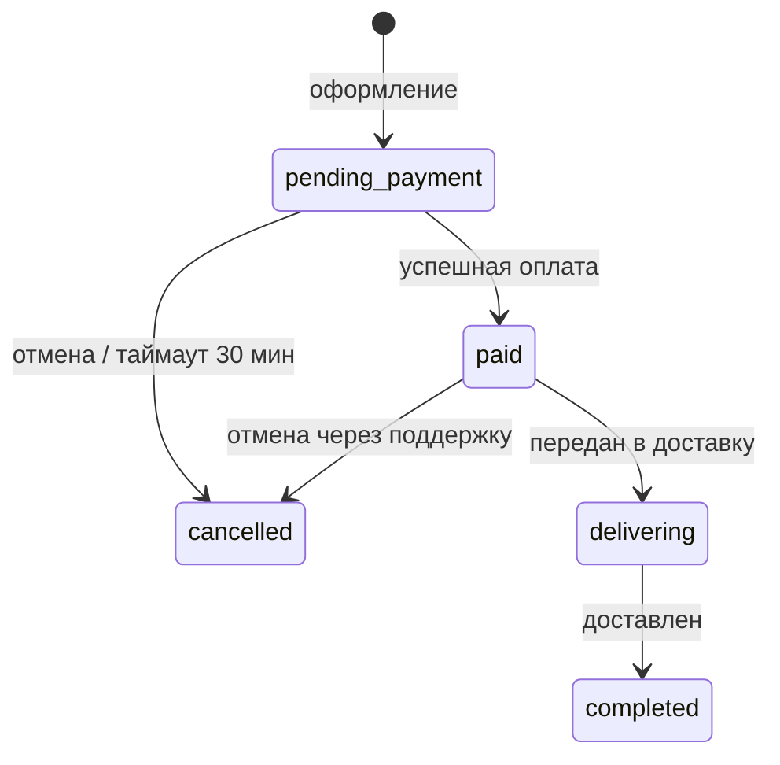

# Техническое задание: «Зелень» — MVP доставки рационов здорового питания

> Документ подготовлен для работы с AI-инженером (Claude Code). Функциональные и нефункциональные требования сгенерированы AI-агентом из пользовательских историй ([user_stories.md](user_stories.md)) по промпту преподавателя; полнота и непротиворечивость ТЗ проверены AI-агентом, решения по замечаниям — в разделе 7. **При расхождении раздел 7 имеет приоритет над разделами 4–6.**

## 1. Описание проекта

### 1.1. Проблема
Людям 25–45 лет, которые хотят питаться правильно, не хватает времени: планирование меню, покупка продуктов и готовка занимают 6–10 часов в неделю. Альтернативы неудобны: доставка ресторанной еды — дорого и нездорово, а существующие сервисы рационов предлагают сложную настройку, долгую регистрацию и непрозрачные цены (стоимость доставки и скидки видны только на последнем шаге).

### 1.2. Решение и ценность
Веб-приложение (адаптивное, mobile-first), в котором можно **за 3–5 минут** выбрать готовый рацион под свою цель на 1, 5 или 7 дней, сразу увидеть итоговую цену со всеми скидками и доставкой, оплатить и выбрать время доставки.

**Ценность для пользователя:**
- экономия времени — не нужно планировать меню и готовить;
- прозрачность — калорийность, состав и итоговая цена видны до оформления;
- выгода — скидка за длительный срок (5 дней −5%, 7 дней −10%), бесплатная доставка от 5000 ₽.

**Ценность для бизнеса:** рационы на 5–7 дней увеличивают средний чек и удержание; простой онлайн-заказ снижает нагрузку на операторов.

### 1.3. Ключевые функции MVP
| # | Функция | Описание |
|---|---|---|
| 1 | **Каталог рационов** | список рационов с фото, калорийностью, ценой за день; фильтр по цели |
| 2 | **Карточка рациона** | меню по дням, КБЖУ, выбор срока 1/5/7 дней с пересчётом цены |
| 3 | **Корзина** | изменение срока и количества, промокод, расчёт скидок и доставки |
| 4 | **Оформление заказа** | адрес, телефон, дата и интервал доставки, оплата онлайн |
| 5 | **Регистрация и вход** | по email (и через Google), история заказов |

### 1.4. Вне рамок MVP
Конструктор рациона из отдельных блюд, AI-рекомендации, собственная логистика и отслеживание курьера, подписка с автопродлением, мобильное приложение для магазинов приложений.

## 2. Целевая аудитория
| Сегмент | Описание | Ключевая потребность |
|---|---|---|
| Занятые специалисты | 25–40 лет, офис или удалёнка, доход средний и выше | питаться правильно без затрат времени |
| Худеющие / следящие за весом | 25–45 лет, считают калории | точная калорийность, рацион под цель |
| Занимающиеся спортом | 20–35 лет, тренировки 3+ раза в неделю | высокобелковый рацион, стабильность |

Общие черты: заказывают с телефона, чувствительны к цене (бюджет ограничен), не готовы тратить время на сложную настройку.

## 3. Требования: зависимости и оптимизация

### 3.1. Зависимости между историями

| История | Зависит от | Характер зависимости |
|---|---|---|
| И1. Проверка зоны доставки | — | Точка входа |
| И2. Каталог программ | — | Каталог открывается и без проверки адреса («Только посмотреть меню», И1) |
| И3. Фильтр по цели | И2 | Фильтрует список карточек каталога |
| И4. Меню программы | И2 | Открывается из карточки программы |
| И5. Длительность и дата старта | И2 | Нужна выбранная программа |
| И6. Слот доставки | И5 | Лимит слота проверяется на выбранную дату |
| И7. Вход по телефону | И5, И6 | Сохраняет черновик (программа, даты, слот) после входа |
| И8. Данные доставки | И1, И7 | Адрес подставляется из И1, шаг доступен после авторизации |
| И9. Проверка заказа | И5, И6, И8 | Показывает параметры и итоговую сумму |
| И10. Промокод | И9, И5, И11 | Применяется на экране И9, условие по длительности из И5, проверка «уже использован» по оплаченным заказам из И11 |
| И11. Оплата | И9 | Сумма платежа равна итогу И9 |
| И12. Подтверждение и чек | И11 | Запускается статусом «Оплачен» |
| И13. «Курьер в пути» | И11, И6, И8 | Нужны оплаченный заказ, слот и заявка у партнёра с комментарием |
| И14. Повтор заказа | И12, И2, И5, И9 | Использует заказ из «Мои заказы», доступность программы, дату старта, переход на экран И9 |

**Критический путь:** И1 → И2 → И5 → И6 → И7 → И8 → И9 → И11 → И12 → И13.

### 3.2. Оптимизация требований

**OPT-1. Единый серверный расчёт стоимости.**
Сейчас сумма вычисляется в четырёх местах:
- И5: пересчёт при выборе длительности;
- И9: итог, доставка и обнаружение изменения цены;
- И10: скидка по промокоду;
- И11: сумма платежа.

Предлагается заменить эти расчёты одной серверной функцией `quote` (группа требований 5). Её вызывают все четыре шага. Цена фиксируется в черновике заказа.

**Проверка на совместимость с требованиями и зависимостями:**

| Проверка | Результат |
|---|---|
| И5: сумма пересчитывается при выборе длительности | Сохраняется: `quote` вызывается при смене длительности |
| И9 (негативный сценарий): «Цена изменилась: было X ₽, стало Y ₽» | Сохраняется: «было» — снимок в черновике, «стало» — новый результат `quote` |
| И10: условие промокода по длительности | Сохраняется: длительность входит в параметры `quote` |
| И11: сумма платежа равна сумме на кнопке | Усиливается: оба значения берутся из одного источника |
| И14: повтор ведёт на экран И9 | Сохраняется: черновик повтора проходит через `quote` |
| Новые пользовательские функции | Не добавляются |

**Итог:** логику и зависимости оптимизация не нарушает, поэтому она принята.

---

## 4. Функциональные требования (по функциям)

### 4.1. Проверка зоны доставки (И1)

| ID | Требование | Тест | Источник |
|---|---|---|---|
| FR-1.1 | Система должна показывать подсказки адресов от геокодера при вводе адреса в поле первого экрана, чтобы пользователь выбрал адрес из списка | Ввести «ул. Ленина, 10» → в списке есть вариант «ул. Ленина, 10» | И1 |
| FR-1.2 | Система должна выводить сообщение «Доставляем по этому адресу» при попадании координат выбранного адреса в полигон зоны доставки, чтобы пользователь перешёл к выбору рациона | Адрес внутри полигона → сообщение отображается | И1 |
| FR-1.3 | Система должна активировать кнопку «Выбрать рацион» при положительной проверке зоны, чтобы пользователь перешёл в каталог | Адрес внутри полигона → кнопка активна и ведёт в каталог | И1 |
| FR-1.4 | Система должна сохранять адрес в сессии при положительной проверке зоны, чтобы подставить его на шаге «Данные доставки» | Проверить адрес → на шаге И8 поле адреса заполнено этим адресом | И1, И8 |
| FR-1.5 | Система должна выводить сообщение «Пока не доставляем по этому адресу» при координатах адреса вне полигона, чтобы пользователь не оформлял недоставляемый заказ | Адрес вне полигона → сообщение отображается | И1 |
| FR-1.6 | Система должна показывать поле «Оставьте телефон — сообщим о запуске» при адресе вне зоны, чтобы собрать контакт для уведомления о запуске | Адрес вне полигона → поле отображается | И1 |
| FR-1.7 | Система должна сохранять введённый телефон вместе с адресом при отправке поля «Оставьте телефон», чтобы сообщить о запуске доставки по адресу | Отправить номер → в БД есть запись «телефон + адрес» | И1 |
| FR-1.8 | Система должна показывать кнопку «Выбрать рацион» с пометкой «Только посмотреть меню» при адресе вне зоны, чтобы пользователь открыл каталог без оформления | Адрес вне полигона → кнопка с пометкой активна | И1 |
| FR-1.9 | Система должна показывать ссылку «Нет моего адреса» при отображении списка подсказок, чтобы пользователь перешёл к ручному вводу | Список подсказок открыт → ссылка видна | И1 |
| FR-1.10 | Система должна открывать форму ручного ввода с полями «Улица», «Дом», «Корпус» при нажатии «Нет моего адреса», чтобы пользователь указал отсутствующий в геокодере адрес | Нажать ссылку → форма с тремя полями открыта | И1 |
| FR-1.11 | Система должна проверять вручную введённый адрес по координатам ближайшего найденного геокодером дома при отправке формы ручного ввода, чтобы определить попадание в зону доставки | Ввести несуществующий в геокодере корпус дома внутри полигона → «Доставляем по этому адресу» | И1 |

### 4.2. Каталог программ и фильтр (И2, И3)

| ID | Требование | Тест | Источник |
|---|---|---|---|
| FR-2.1 | Система должна отображать для каждой опубликованной программы карточку с названием, ккал/день, числом приёмов пищи и ценой «от N ₽/день» при открытии каталога, чтобы пользователь сравнил программы | 4 опубликованные программы → 4 карточки, в каждой 4 поля | И2 |
| FR-2.2 | Система должна показывать на карточке метку «Нет мест до ДД.ММ» при отсутствии свободных мест на программу в ближайшие 7 дней, чтобы пользователь знал дату доступности | Нет мест на 7 дней → метка с первой доступной датой | И2 |
| FR-2.3 | Система должна делать кнопку «Выбрать» неактивной при отсутствии свободных мест на программу в ближайшие 7 дней, чтобы исключить заказ без мест | Нет мест на 7 дней → кнопка не реагирует на нажатие | И2 |
| FR-2.4 | Система должна отображать только программы с тегом выбранной цели при выборе фильтра, чтобы пользователь сравнивал только подходящие программы | Фильтр «Снижение веса» → в списке только программы с этим тегом | И3 |
| FR-2.5 | Система должна показывать счётчик найденных программ при применённом фильтре, чтобы пользователь видел размер выборки | 2 программы с тегом → счётчик «2» | И3 |
| FR-2.6 | Система должна выводить сообщение «Нет программ для этой цели» и кнопку «Сбросить фильтр» при пустом результате фильтра, чтобы пользователь вернулся к полному каталогу | Фильтр без совпадений → сообщение и кнопка видны | И3 |
| FR-2.7 | Система должна показывать все опубликованные программы при нажатии «Сбросить фильтр», чтобы восстановить полный каталог | Нажать кнопку → число карточек равно числу опубликованных программ | И3 |

### 4.3. Меню программы (И4)

| ID | Требование | Тест | Источник |
|---|---|---|---|
| FR-3.1 | Система должна показывать блюда выбранного дня при нажатии на вкладку дня (Пн–Вс), чтобы пользователь изучил меню по дням | Вкладка «Вт» → только блюда вторника | И4 |
| FR-3.2 | Система должна открывать карточку блюда с фото, весом в граммах, составом, КБЖУ и списком аллергенов при нажатии на блюдо, чтобы пользователь проверил блюдо до оплаты | Нажать блюдо → в карточке все 5 полей | И4 |
| FR-3.3 | Система должна выводить над меню период «Меню на неделю с ДД.ММ по ДД.ММ» при открытии программы, чтобы пользователь понимал, к какой неделе относится меню | Открыть программу → период совпадает с датами опубликованного меню | И4 |
| FR-3.4 | Система должна блокировать публикацию меню с ошибкой «Не указаны аллергены для блюда X» при пустом поле «Аллергены» хотя бы у одного блюда, чтобы исключить показ блюд без аллергенов | Опубликовать меню с блюдом без аллергенов → публикация отклонена, ошибка с названием блюда | И4 |
| FR-3.5 | Система должна скрывать от пользователя блюдо при пустом поле «Аллергены», чтобы пользователь видел только полностью описанные блюда | Блюдо без аллергенов → отсутствует в клиентском меню | И4 |
| FR-3.6 | Система должна выводить сообщение «Меню появится ДД.ММ» с плановой датой публикации при переключении на неделю без опубликованного меню, чтобы пользователь знал срок появления меню | Следующая неделя не опубликована → сообщение с датой | И4 |

### 4.4. Параметры заказа: длительность, дата, слот (И5, И6)

| ID | Требование | Тест | Источник |
|---|---|---|---|
| FR-4.1 | Система должна предлагать длительность 1, 5 или 7 дней при выборе программы, чтобы пользователь заказал пробный день или период | Открыть шаг → ровно 3 варианта: 1, 5, 7 | И5 |
| FR-4.2 | Система должна активировать кнопку «Далее» при выбранных длительности и дате старта, чтобы пользователь перешёл к следующему шагу | Выбрать «1 день» и дату → кнопка активна | И5 |
| FR-4.3 | Система должна делать дату «завтра» неактивной с подсказкой «Заказ на завтра принимается до 18:00» при текущем времени позже 18:00, чтобы исключить заказ после дедлайна | 18:05 → «завтра» неактивна, первая активная дата — «послезавтра» | И5 |
| FR-4.4 | Система должна показывать слоты «06:00–08:30» и «19:00–22:00 накануне» при выбранной дате старта, чтобы пользователь выбрал время доставки | Выбрать дату → 2 слота в списке | И6 |
| FR-4.5 | Система должна отмечать слот как выбранный при нажатии на него, чтобы пользователь видел свой выбор | Нажать «06:00–08:30» → слот в состоянии «выбран» | И6 |
| FR-4.6 | Система должна выводить под выбранным слотом пояснение «Доставка каждый день в этот интервал» при выборе слота, чтобы пользователь понимал график доставки | Выбрать слот → пояснение видно | И6 |
| FR-4.7 | Система должна делать слот неактивным с меткой «Мест нет» при достижении лимита заказов, полученного от логистического партнёра на эту дату, чтобы исключить заказ без возможности доставки | Лимит партнёра исчерпан → слот неактивен, метка видна | И6 |

### 4.5. Расчёт стоимости (OPT-1; И5, И9, И10, И11)

| ID | Требование | Тест | Источник |
|---|---|---|---|
| FR-5.1 | Система должна рассчитывать итоговую сумму (стоимость рациона за выбранное число дней + стоимость доставки − скидка по промокоду) одной серверной функцией `quote` при каждом изменении программы, длительности, даты или промокода, чтобы сумма совпадала на всех шагах | Изменить длительность → сумма на шаге И5 и на экране «Ваш заказ» совпадает с ответом `quote` | И5, И9, И10 |
| FR-5.2 | Система должна отображать сумму в формате «N ₽ за K дн.» при выборе длительности, чтобы пользователь видел стоимость периода | Выбрать «1 день» → «N ₽ за 1 день», N = ответ `quote` | И5 |
| FR-5.3 | Система должна сохранять в черновике заказа снимок цены программы при создании черновика, чтобы обнаружить изменение цены до оплаты | Создать черновик → в БД есть поле с ценой на момент создания | И9 |
| FR-5.4 | Система должна передавать платёжному провайдеру сумму, равную текущему результату `quote`, при создании платежа, чтобы списание совпадало с суммой на кнопке «Оплатить N ₽» | Сумма в запросе к провайдеру = N на кнопке | И9, И11 |

### 4.6. Авторизация по телефону (И7)

| ID | Требование | Тест | Источник |
|---|---|---|---|
| FR-6.1 | Система должна открывать экран ввода номера телефона при нажатии «Оформить» неавторизованным пользователем, чтобы пользователь вошёл перед оформлением | Неавторизован → «Оформить» → экран ввода номера | И7 |
| FR-6.2 | Система должна отправлять SMS с 4-значным кодом при отправке номера телефона, чтобы подтвердить владение номером | Отправить номер → SMS с 4 цифрами получено | И7 |
| FR-6.3 | Система должна авторизовать пользователя при вводе верного кода не позднее 5 минут после отправки, чтобы пользователь продолжил оформление | Верный код через 4:59 → авторизован, через 5:01 → отказ | И7 |
| FR-6.4 | Система должна сохранять программу, даты и слот черновика при успешной авторизации, чтобы пользователь не выбирал их повторно | Войти → черновик содержит прежние программу, даты, слот | И7 |
| FR-6.5 | Система должна открывать шаг «Данные доставки» при успешной авторизации, чтобы продолжить оформление | Войти → открыт шаг И8 | И7 |
| FR-6.6 | Система должна выводить ошибку «Неверный код» при вводе неверного кода, чтобы пользователь повторил ввод | Ввести неверный код → ошибка видна | И7 |
| FR-6.7 | Система должна блокировать ввод кода на 5 минут при третьем неверном вводе подряд, чтобы защитить аккаунт от перебора | 3 неверных кода → поле неактивно 300 с | И7 |
| FR-6.8 | Система должна показывать таймер до следующей попытки при блокировке ввода кода, чтобы пользователь знал время ожидания | Блокировка → таймер отсчитывает от 05:00 | И7 |
| FR-6.9 | Система должна держать кнопку «Отправить снова» неактивной с обратным отсчётом в течение 60 секунд после отправки кода, чтобы ограничить частоту SMS | Отправить код → кнопка неактивна 60 с, затем активна | И7 |

### 4.7. Данные доставки (И8)

| ID | Требование | Тест | Источник |
|---|---|---|---|
| FR-7.1 | Система должна подставлять адрес из проверки зоны доставки при открытии шага «Данные доставки», чтобы пользователь не вводил его повторно | Адрес из И1 = значение поля адреса | И8 |
| FR-7.2 | Система должна требовать заполнения поля «Квартира/офис» при неотмеченном чекбоксе «Частный дом», чтобы курьер нашёл получателя | Пустое поле, чекбокс снят → переход запрещён; чекбокс отмечен → переход разрешён | И8 |
| FR-7.3 | Система должна прокручивать экран к полю «Квартира/офис» и выводить ошибку «Укажите квартиру или отметьте „Частный дом“» при нажатии «Далее» с незаполненным обязательным полем, чтобы пользователь исправил ошибку | Нажать «Далее» → поле в зоне видимости, ошибка видна | И8 |
| FR-7.4 | Система должна сохранять квартиру, подъезд, этаж, домофон и комментарий в заказе при нажатии «Далее» с валидными данными, чтобы передать их в доставку | Нажать «Далее» → все поля сохранены в заказе | И8 |
| FR-7.5 | Система должна передавать комментарий курьеру в поле `comment` запроса к API логистического партнёра при создании заявки на доставку, чтобы курьер получил инструкции | Запрос к партнёру содержит `comment` = текст пользователя | И8 |
| FR-7.6 | Система должна запрещать ввод более 250 символов в поле комментария и показывать счётчик «N/250» при вводе, чтобы комментарий принимался API партнёра | Ввести 251-й символ → символ не добавлен, счётчик «250/250» | И8 |

### 4.8. Проверка заказа (И9)

| ID | Требование | Тест | Источник |
|---|---|---|---|
| FR-8.1 | Система должна отображать программу, даты, слот, адрес, стоимость рациона, стоимость доставки и итоговую сумму при открытии экрана «Ваш заказ», чтобы пользователь проверил заказ до оплаты | Открыть экран → все 7 полей видны | И9 |
| FR-8.2 | Система должна отображать строку «Отмена бесплатно до 18:00 накануне первой доставки» со ссылкой на оферту при открытии экрана «Ваш заказ», чтобы пользователь знал условия отмены | Строка и рабочая ссылка на оферту видны | И9 |
| FR-8.3 | Система должна показывать на кнопке текст «Оплатить N ₽» с N, равным результату `quote`, при открытии экрана «Ваш заказ», чтобы пользователь видел сумму списания | N на кнопке = итоговой сумме | И9 |
| FR-8.4 | Система должна запрещать переход к оплате и подсвечивать чекбокс с ошибкой «Примите условия оферты» при нажатии «Оплатить» с неотмеченным чекбоксом оферты, чтобы получить согласие с офертой | Чекбокс снят → нажать «Оплатить» → переход не произошёл, ошибка видна | И9 |
| FR-8.5 | Система должна выводить уведомление «Цена изменилась: было X ₽, стало Y ₽» при расхождении снимка цены в черновике и текущей цены, чтобы пользователь видел изменение до оплаты | Изменить цену в админке → уведомление с обеими суммами | И9 |
| FR-8.6 | Система должна использовать новую цену в итоговой сумме при изменении цены после создания черновика, чтобы оплата шла по актуальной цене | После изменения цены итог = расчёт по новой цене | И9 |

### 4.9. Промокоды (И10)

| ID | Требование | Тест | Источник |
|---|---|---|---|
| FR-9.1 | Система должна применять скидку и выводить строку «Скидка −N ₽» при вводе активного промокода, условия которого выполнены, чтобы уменьшить итоговую сумму | «START15» (15 %) → итог уменьшен на 15 % стоимости, строка видна | И10 |
| FR-9.2 | Система должна выводить ошибку с невыполненным условием (например, «Промокод действует на заказы от 5 дней») без изменения суммы при длительности заказа меньше минимальной для промокода, чтобы пользователь понял причину отказа | «WEEK10» при 1 дне → ошибка, итог не изменился | И10 |
| FR-9.3 | Система должна выводить ошибку «Промокод уже использован» при вводе промокода, уже применённого этим пользователем в оплаченном заказе, чтобы исключить повторное использование | Повторный ввод «START15» → ошибка, итог не изменился | И10 |

### 4.10. Оплата (И11)

| ID | Требование | Тест | Источник |
|---|---|---|---|
| FR-10.1 | Система должна предлагать способы оплаты «СБП» и «Банковская карта» при переходе к оплате, чтобы пользователь выбрал привычный способ | Экран оплаты → ровно 2 способа | И11 |
| FR-10.2 | Система должна присваивать заказу статус «Оплачен» при получении webhook платёжного провайдера со статусом `succeeded`, чтобы зафиксировать оплату | Отправить тестовый webhook `succeeded` → статус «Оплачен» | И11 |
| FR-10.3 | Система должна открывать экран «Заказ оформлен» при статусе заказа «Оплачен», чтобы пользователь получил подтверждение | Статус «Оплачен» → экран открыт | И11 |
| FR-10.4 | Система должна сохранять статус «Ожидает оплаты» и выводить сообщение «Платёж не прошёл. Деньги не списаны» при отклонении платежа банком, чтобы пользователь знал результат | Webhook отказа → статус не изменился, сообщение видно | И11 |
| FR-10.5 | Система должна показывать кнопку «Попробовать снова», которая создаёт новый платёж с сохранёнными данными заказа, при отклонённом платеже, чтобы пользователь повторил оплату без повторного ввода | Нажать кнопку → новый платёж, параметры заказа не изменились | И11 |
| FR-10.6 | Система должна показывать экран «Проверяем оплату» и запрашивать статус платежа каждые 3 секунды в течение 60 секунд при возврате пользователя до получения webhook, чтобы определить результат оплаты | Возврат без webhook → 20 запросов статуса за 60 с | И11 |
| FR-10.7 | Система должна выводить сообщение «Статус уточняется — пришлём SMS» при отсутствии статуса платежа через 60 секунд опроса, чтобы пользователь знал, что результат придёт позже | 60 с без статуса → сообщение видно | И11 |

### 4.11. Подтверждение и уведомления (И12, И13, И14)

| ID | Требование | Тест | Источник |
|---|---|---|---|
| FR-11.1 | Система должна отправлять SMS с номером заказа, датами и слотом доставки при переходе заказа в статус «Оплачен», чтобы пользователь получил подтверждение | Статус «Оплачен» → SMS содержит 3 элемента | И12 |
| FR-11.2 | Система должна инициировать отправку кассового чека через онлайн-кассу провайдера на email или телефон пользователя при переходе заказа в статус «Оплачен», чтобы выполнить требования 54-ФЗ | Оплаченный заказ → в онлайн-кассе есть чек с суммой заказа | И12 |
| FR-11.3 | Система должна отображать заказ в разделе «Мои заказы» при статусе «Оплачен», чтобы пользователь видел свои заказы | Оплатить → заказ в списке | И12 |
| FR-11.4 | Система должна повторять отправку SMS до 3 раз с интервалом 1 минута при ошибке SMS-провайдера, чтобы доставить подтверждение | Мок ошибки провайдера → 3 повторных запроса с интервалом 60 с | И12 |
| FR-11.5 | Система должна создавать задачу в поддержку с номером заказа при неудаче всех 3 повторных отправок SMS, чтобы поддержка связалась с пользователем | 3 неудачи → задача создана | И12 |
| FR-11.6 | Система должна показывать номер и детали заказа на экране «Заказ оформлен» при статусе «Оплачен» независимо от результата отправки SMS, чтобы пользователь получил подтверждение в интерфейсе | Мок ошибки SMS → экран показывает номер и детали | И12 |
| FR-11.7 | Система должна отправлять SMS «Курьер в пути, будет в интервале HH:MM–HH:MM» со ссылкой на трекинг при получении от логистического партнёра статуса «Курьер забрал заказ», чтобы пользователь подготовился к получению | Webhook статуса → SMS с интервалом и ссылкой | И13 |
| FR-11.8 | Система должна отправлять алерт с номером заказа в канал поддержки при отсутствии статуса «Курьер забрал заказ» за 30 минут до конца слота, чтобы поддержка выяснила причину у партнёра | Нет статуса в T−30 мин → алерт в канале | И13 |
| FR-11.9 | Система должна не отправлять SMS «Курьер в пути» при отсутствии статуса «Курьер забрал заказ» от партнёра, чтобы исключить ложные уведомления | Нет статуса → SMS «Курьер в пути» не отправлено | И13 |
| FR-11.10 | Система должна отправлять в 12:00 SMS «Ваш рацион заканчивается завтра» со ссылкой на повтор заказа при наличии заказа, у которого завтра последний день доставки, чтобы пользователь продлил питание без перерыва | Заказ с последней доставкой завтра → SMS в 12:00 со ссылкой | И14 |

### 4.12. Повтор заказа (И14)

| ID | Требование | Тест | Источник |
|---|---|---|---|
| FR-12.1 | Система должна создавать черновик заказа с той же программой, длительностью, слотом и адресом при нажатии «Повторить заказ», чтобы пользователь не выбирал параметры заново | Нажать кнопку → 4 параметра черновика равны исходному заказу | И14 |
| FR-12.2 | Система должна устанавливать дату старта черновика на день после последней доставки исходного заказа при повторе заказа, чтобы питание шло без перерыва | Последняя доставка 20.10 → дата старта 21.10 | И14 |
| FR-12.3 | Система должна открывать экран «Ваш заказ» при создании черновика повтора, чтобы пользователь проверил и оплатил заказ | Нажать кнопку → открыт экран «Ваш заказ» | И14 |
| FR-12.4 | Система должна выводить сообщение «Программа больше недоступна» и открывать каталог с сохранёнными адресом и слотом при повторе заказа со снятой с продажи программой, чтобы пользователь выбрал другую программу | Снять программу → нажать кнопку → сообщение, каталог, адрес и слот в черновике | И14 |

---

## 5. Нефункциональные требования (по функциям)

### 5.1. Адаптивность интерфейса

| ID | Требование | Метрика / тест | Источник |
|---|---|---|---|
| NFR-1.1 | Система должна отображать каталог программ без горизонтальной прокрутки при ширине экрана 360 px, чтобы им было удобно пользоваться со смартфона | `document.scrollWidth` ≤ 360 при viewport 360 px | И2 |

### 5.2. Время отклика и таймеры

| ID | Требование | Метрика / тест | Источник |
|---|---|---|---|
| NFR-2.1 | Система должна отправлять SMS-подтверждение не позднее 120 секунд после перехода заказа в статус «Оплачен», чтобы пользователь быстро получил подтверждение | Разница между временем статуса и временем отправки ≤ 120 с | И12 |
| NFR-2.2 | Система должна опрашивать статус платежа с интервалом 3 секунды и прекращать опрос через 60 секунд при отсутствии webhook, чтобы ограничить нагрузку на API провайдера | Интервал 3 с ± 0,5 с, всего 20 запросов | И11 |
| NFR-2.3 | Система должна проверять статус «Курьер забрал заказ» за 30 минут до окончания слота доставки, чтобы поддержка успела вмешаться | Проверка срабатывает в момент T_конца_слота − 30 мин | И13 |
| NFR-2.4 | Система должна отправлять напоминание об окончании рациона в 12:00 по часовому поясу зоны доставки, чтобы время отправки было единым для всех пользователей | Время отправки = 12:00 локального времени зоны | И14 |
| NFR-2.5 | Система должна применять дедлайн приёма заказа на завтра 18:00 по часовому поясу зоны доставки, чтобы граница дедлайна не зависела от часового пояса устройства | Устройство в UTC+5, зона в UTC+3, 18:05 по зоне → «завтра» неактивна | И5 |

### 5.3. Безопасность авторизации

| ID | Требование | Метрика / тест | Источник |
|---|---|---|---|
| NFR-3.1 | Система должна генерировать одноразовый код длиной ровно 4 цифры со сроком действия 300 секунд при каждом запросе кода, чтобы ограничить окно использования кода | Длина = 4, код отклоняется через 301 с | И7 |
| NFR-3.2 | Система должна допускать не более 3 неверных вводов кода подряд и блокировать ввод на 300 секунд после третьего, чтобы ограничить перебор | 4-я попытка в течение 300 с отклонена без проверки кода | И7 |
| NFR-3.3 | Система должна отправлять не более 1 SMS с кодом на номер за 60 секунд, чтобы ограничить расходы на SMS и злоупотребления | 2 запроса за 60 с → отправлено 1 SMS | И7 |

### 5.4. Надёжность интеграций

| ID | Требование | Метрика / тест | Источник |
|---|---|---|---|
| NFR-4.1 | Система должна выполнять 3 повторные попытки отправки SMS с интервалом 60 секунд при ошибке SMS-провайдера, чтобы уведомление было доставлено | Мок ошибки → 3 попытки, интервал 60 с ± 5 с | И12 |
| NFR-4.2 | Система должна создавать задачу в поддержку для 100 % заказов, по которым все 3 повторные отправки SMS неудачны, чтобы ни один такой заказ не остался без контакта | Количество задач = количеству заказов с 3 неудачами | И12 |
| NFR-4.3 | Система должна ограничивать комментарий курьеру длиной 250 символов, чтобы 100 % запросов к API партнёра проходили валидацию длины | 0 ошибок валидации `comment` у партнёра | И8 |

### 5.5. Целостность данных

| ID | Требование | Метрика / тест | Источник |
|---|---|---|---|
| NFR-5.1 | Система должна обеспечивать заполненное поле «Аллергены» у 100 % блюд, видимых пользователю, чтобы пользователь с аллергией принимал решение на полных данных | Запрос к клиентскому API меню: 0 блюд с пустыми аллергенами | И4 |
| NFR-5.2 | Система должна обеспечивать нулевое расхождение между суммой на кнопке «Оплатить N ₽» и суммой платежа у провайдера, чтобы списание совпадало с показанной суммой | Сверка за период: 0 заказов с расхождением | И9, И11, OPT-1 |
| NFR-5.3 | Система должна рассчитывать доступность программы на горизонте 7 дней от текущей даты, чтобы метка «Нет мест до ДД.ММ» считалась одинаково для всех карточек | Нет мест на дни 1–7, есть на день 8 → метка с датой дня 8 | И2 |

### 5.6. Соответствие законодательству

| ID | Требование | Метрика / тест | Источник |
|---|---|---|---|
| NFR-6.1 | Система должна формировать кассовый чек по 54-ФЗ для 100 % заказов в статусе «Оплачен», чтобы сервис соблюдал требования к онлайн-кассам | Количество чеков = количеству оплаченных заказов за период | И12 |

## 6. Обработка ошибок и негативные сценарии

Для каждой функции ниже разобраны четыре типа сценариев:

- **Валидация** — ошибки валидации;
- **Пусто** — нет данных (пустые состояния);
- **Сеть** — таймаут, 5xx, офлайн;
- **Доступ** — 401, 403 или истёкшая сессия.

### 0. Общие правила (действуют во всех разделах)

| Правило | Решение |
|---|---|
| Офлайн | Над контентом фиксированный баннер «Нет соединения с интернетом». Кнопки, которые отправляют данные, неактивны. Когда связь возвращается (событие `online`), запросы автоматически повторяются, а баннер скрывается. |
| Таймаут запроса | Чтение — 5 с, запись — 10 с. Автоповтор только для идемпотентных запросов: 1 раз через 2 с. Потом показывается сообщение и кнопка «Повторить». |
| Черновик заказа | Хранится одновременно в `localStorage` и на сервере (после входа). При сетевой ошибке или потере сессии введённые данные не теряются. |
| 401 | Сначала система тихо обновляет токен. Если это не удалось, открывается экран входа с `return_url` на текущий шаг. После входа повторяется действие, на котором произошла ошибка. |
| 403 на чужой ресурс | Пользователь видит «Заказ не найден» (как при 404), чтобы не раскрывать, существует ли заказ. |
| Ошибки 5xx | Пользователь не видит технических кодов. Каждая ошибка пишется в лог с `request_id`. |

---

### 1. Проверка зоны доставки (И1)

| № | Тип | Что произошло | Что видит пользователь | UX-решение |
|---|---|---|---|---|
| 1.1 | Валидация | Введено меньше 3 символов | Подсказка под полем: «Введите минимум 3 символа» | Запрос к геокодеру не отправляется (debounce 300 мс) |
| 1.2 | Валидация | Выбрана улица без номера дома | «Укажите номер дома» | Проверка зоны не запускается. Подсказки продолжают поиск по введённой строке |
| 1.3 | Валидация | При ручном вводе не найден ближайший дом | «Не удалось найти адрес. Проверьте улицу и номер дома» | Форма сохраняет введённые значения, подсвечивается поле «Дом» |
| 1.4 | Пусто | Геокодер не вернул подсказок | «Ничего не нашли. Проверьте написание или введите адрес вручную» | Под сообщением ссылка «Нет моего адреса» |
| 1.5 | Сеть | Таймаут или 5xx геокодера | «Подсказки адресов временно недоступны. Введите адрес вручную» | Форма ручного ввода открывается автоматически |
| 1.6 | Сеть | 5xx сервиса проверки зоны | «Не удалось проверить адрес. Попробуйте ещё раз» | Адрес остаётся в поле, есть кнопка «Повторить». Кнопка «Выбрать рацион» доступна с пометкой «Только посмотреть меню» |
| 1.7 | Сеть | Офлайн | «Нет соединения с интернетом. Проверим адрес, когда связь восстановится» | Адрес сохраняется. После события `online` проверка запускается автоматически |
| 1.8 | Доступ | Антибот-защита вернула 403 или 429 на форму «Оставьте телефон» | «Слишком много попыток. Попробуйте через 10 минут» | Номер остаётся в поле, кнопка отправки неактивна 10 минут |

### 2. Каталог программ и фильтр (И2, И3)

| № | Тип | Что произошло | Что видит пользователь | UX-решение |
|---|---|---|---|---|
| 2.1 | Валидация | В URL неизвестная цель фильтра (`?goal=xyz`) | Сообщения нет, показан полный каталог | Параметр игнорируется и удаляется из URL |
| 2.2 | Пусто | Нет ни одной опубликованной программы | «Скоро здесь появятся программы питания. Оставьте телефон — сообщим о запуске» | Поле телефона, лид сохраняется так же, как в FR-1.7 |
| 2.3 | Пусто | Фильтр не нашёл программ | «Нет программ для этой цели» | Кнопка «Сбросить фильтр» |
| 2.4 | Пусто | Ни у одной программы нет мест на 7 дней | Баннер: «Все места на ближайшие 7 дней заняты. Ближайшая дата — ДД.ММ» | Карточки показываются с меткой «Нет мест до ДД.ММ», кнопки «Выбрать» неактивны |
| 2.5 | Сеть | Таймаут или 5xx при загрузке каталога | «Не удалось загрузить программы» | Скелетон заменяется сообщением. Сначала автоповтор через 2 с, затем кнопка «Повторить» |
| 2.6 | Сеть | Офлайн, каталог был загружен раньше | «Нет соединения. Показаны данные от HH:MM, цены и места обновятся после подключения» | Каталог берётся из кэша, кнопки «Выбрать» неактивны до подключения |
| 2.7 | Доступ | Сессия истекла во время просмотра каталога | Сообщения нет | Каталог публичный и работает в гостевом режиме. Черновик в `localStorage` сохраняется, вход запрашивается по нажатию «Оформить» |

### 3. Меню программы (И4)

| № | Тип | Что произошло | Что видит пользователь | UX-решение |
|---|---|---|---|---|
| 3.1 | Валидация | Контент-менеджер публикует меню с блюдом без аллергенов | Админка: «Не указаны аллергены для блюда X» | Публикация блокируется, поле подсвечивается (FR-3.4) |
| 3.2 | Валидация | В URL указан несуществующий день (`?day=8`) | Сообщения нет | Открывается вкладка ближайшего дня доставки |
| 3.3 | Пусто | Меню недели не опубликовано | «Меню появится ДД.ММ» | Вкладки дней скрыты, есть кнопка «Смотреть текущую неделю» |
| 3.4 | Пусто | В выбранный день нет блюд (например, выходной в программе на 5 дней) | «В этот день доставки нет» | Вкладка дня неактивна и отмечена серым |
| 3.5 | Пусто | У блюда нет фото | Заглушка с подписью «Фото скоро появится» | Остальные поля карточки отображаются полностью |
| 3.6 | Сеть | Таймаут или 5xx при загрузке карточки блюда | «Не удалось загрузить состав блюда» | Карточка не открывается частично: состав и аллергены показываются только вместе. Есть кнопка «Повторить» |
| 3.7 | Сеть | Офлайн | «Нет соединения с интернетом» | Вкладки, загруженные раньше, остаются доступны, незагруженные неактивны |
| 3.8 | Доступ | У контент-менеджера истекла сессия при сохранении меню (401) | «Сессия истекла. Войдите снова — изменения сохранены в черновике» | Форма сохраняется в `localStorage`. После входа восстанавливается и сохранение повторяется |

### 4. Длительность, дата старта и слот (И5, И6)

| № | Тип | Что произошло | Что видит пользователь | UX-решение |
|---|---|---|---|---|
| 4.1 | Валидация | Не выбрана длительность или дата | Под кнопкой: «Выберите длительность и дату начала» | Кнопка «Далее» неактивна (FR-4.2) |
| 4.2 | Валидация | Экран открыт в 17:59, «Далее» нажато в 18:01, сервер отклонил дату | «Приём заказов на завтра закрыт в 18:00. Выберите другую дату» | Дата сбрасывается на первую доступную, длительность и слот сохраняются |
| 4.3 | Валидация | Слот заполнился между просмотром и выбором (409) | «На этот интервал мест не осталось. Выберите другой» | Список слотов перезагружается, выбор снимается |
| 4.4 | Пусто | На выбранную дату заполнены все слоты | «На ДД.ММ мест нет. Ближайшая свободная дата — ДД.ММ» | Кнопка «Выбрать ДД.ММ» подставляет эту дату |
| 4.5 | Пусто | В горизонте календаря нет ни одной свободной даты | «Свободных дат нет. Оставьте телефон — сообщим, когда появятся места» | Поле телефона, лид сохраняется с ID программы |
| 4.6 | Сеть | Таймаут или 5xx API партнёра при запросе лимитов слотов | «Не удалось загрузить интервалы доставки» | Без подтверждённого лимита слоты не показываются. Автоповтор 3 раза (через 1, 2, 4 с), затем кнопка «Повторить» |
| 4.7 | Сеть | Офлайн | «Нет соединения. Ваш выбор сохранён» | Выбор хранится в `localStorage`, после подключения восстанавливается |
| 4.8 | Доступ | Сессия истекла на этом шаге | Сообщения нет | Шаг доступен гостю. Вход запрашивается на шаге «Оформить» (И7), черновик сохраняется |

### 5. Расчёт стоимости (`quote`, OPT-1)

| № | Тип | Что произошло | Что видит пользователь | UX-решение |
|---|---|---|---|---|
| 5.1 | Валидация | Программу сняли с продажи, пока пользователь оформлял заказ | «Программа больше недоступна» | Переход в каталог, адрес и слот остаются в черновике |
| 5.2 | Пусто | У программы нет цены (ошибка настройки) | «Не удалось рассчитать стоимость. Выберите другую программу» | Программа скрывается из каталога, в мониторинг отправляется алерт |
| 5.3 | Сеть | Пересчёт длится больше 1 с | Прежняя сумма серым цветом, под ней «Пересчитываем стоимость…» | Кнопки «Далее» и «Оплатить» неактивны, пока сумма не актуальна |
| 5.4 | Сеть | Таймаут или 5xx `quote` | «Не удалось рассчитать стоимость» | Кнопка «Повторить». Оплата по неподтверждённой сумме запрещена |
| 5.5 | Сеть | Офлайн | «Нет соединения. Сумма обновится после подключения» | Кнопки перехода неактивны, после события `online` `quote` вызывается снова |
| 5.6 | Доступ | 401 при пересчёте с промокодом | Открывается экран входа | Промокод сохраняется в черновике и после входа применяется повторно |

### 6. Авторизация по SMS (И7)

| № | Тип | Что произошло | Что видит пользователь | UX-решение |
|---|---|---|---|---|
| 6.1 | Валидация | Номер неполный | «Введите номер полностью: +7 XXX XXX-XX-XX» | Маска ввода. Пока номер неполный, кнопка «Получить код» неактивна |
| 6.2 | Валидация | Код страны не +7 | «Сейчас принимаем только российские номера (+7)» | Префикс +7 зафиксирован в маске |
| 6.3 | Валидация | Неверный код | «Неверный код. Осталось попыток: N» | Поле очищается, фокус остаётся в поле |
| 6.4 | Валидация | Третий неверный код | «Слишком много попыток. Повторите через 04:59» | Ввод заблокирован на 5 минут, таймер идёт (FR-6.7, FR-6.8) |
| 6.5 | Валидация | Код введён позже, чем через 5 минут | «Код устарел. Запросите новый» | Кнопка «Отправить снова» активна сразу |
| 6.6 | Пусто | Введено меньше 4 цифр кода | Сообщения нет | Код отправляется автоматически после 4-й цифры. Поддерживается автоподстановка `autocomplete="one-time-code"` |
| 6.7 | Сеть | Таймаут или 5xx SMS-провайдера | «Не удалось отправить SMS. Попробуйте ещё раз через минуту» | Таймер 60 с, неудачная отправка не считается попыткой |
| 6.8 | Сеть | Таймаут проверки кода | «Не удалось проверить код. Проверьте соединение» | Введённый код сохраняется, есть кнопка «Повторить». Попытка не засчитывается |
| 6.9 | Сеть | Офлайн | «Нет соединения с интернетом» | Кнопки «Получить код» и «Войти» неактивны |
| 6.10 | Доступ | 429 или 403: больше 5 SMS на номер за час | «Превышен лимит SMS. Попробуйте через 60 минут» | Кнопка отправки неактивна, черновик заказа сохранён |
| 6.11 | Доступ | Refresh-токен истёк во время оформления | «Сессия истекла. Войдите снова — заказ сохранён» | Экран входа с `return_url` на текущий шаг, черновик восстанавливается после входа |

### 7. Данные доставки (И8)

| № | Тип | Что произошло | Что видит пользователь | UX-решение |
|---|---|---|---|---|
| 7.1 | Валидация | Пустое поле «Квартира/офис» без отметки «Частный дом» | «Укажите квартиру или отметьте „Частный дом“» | Экран прокручивается к полю (FR-7.3) |
| 7.2 | Валидация | Комментарий длиннее 250 символов | Счётчик «250/250» | Ввод сверх лимита блокируется, вставка обрезается до 250 символов |
| 7.3 | Валидация | Неверный телефон получателя | «Проверьте номер получателя» | Маска +7, поле подсвечивается |
| 7.4 | Валидация | Этаж введён не числом | «Укажите этаж числом» | В поле открывается числовая клавиатура (`inputmode="numeric"`) |
| 7.5 | Валидация | Адрес изменили на адрес вне зоны | «По этому адресу пока не доставляем» | Кнопка «Далее» неактивна, пока адрес вне зоны |
| 7.6 | Пусто | Адреса нет в сессии (вход с другого устройства) | Поле адреса пустое, подсказка «Укажите адрес доставки» | Проверка зоны встроена прямо в поле (логика И1) |
| 7.7 | Сеть | Таймаут или 5xx при сохранении | «Не удалось сохранить данные. Попробуйте ещё раз» | Данные формы остаются в `localStorage`, есть кнопка «Повторить» |
| 7.8 | Сеть | Офлайн | «Нет соединения. Данные сохранены на устройстве» | После события `online` форма отправляется автоматически |
| 7.9 | Доступ | 401 при сохранении | Открывается экран входа | После входа сохранение повторяется с данными из `localStorage` |
| 7.10 | Доступ | 403: черновик принадлежит другому пользователю (переход по чужой ссылке) | «Заказ не найден» | Создаётся новый черновик, переход в каталог |

### 8. Проверка заказа (И9)

| № | Тип | Что произошло | Что видит пользователь | UX-решение |
|---|---|---|---|---|
| 8.1 | Валидация | Не принята оферта | «Примите условия оферты» | Переход к оплате блокируется, чекбокс подсвечивается (FR-8.4) |
| 8.2 | Валидация | Цена изменилась | «Цена изменилась: было X ₽, стало Y ₽» | Сумма на кнопке обновляется до Y (FR-8.5, FR-8.6) |
| 8.3 | Валидация | Слот заполнился или дедлайн прошёл, пока открыт экран | «Интервал HH:MM–HH:MM на ДД.ММ больше недоступен» | Возврат на шаг выбора даты и слота, программа и адрес сохраняются |
| 8.4 | Пусто | Черновик не найден (удалён или истёк) | «Заказ не найден. Начните оформление заново» | Кнопка «В каталог». Адрес из сессии сохраняется |
| 8.5 | Сеть | Таймаут или 5xx при загрузке экрана | «Не удалось загрузить заказ» | Кнопка «Повторить», кнопка «Оплатить» неактивна |
| 8.6 | Сеть | Офлайн | «Нет соединения. Оплата станет доступна после подключения» | Кнопка «Оплатить» неактивна, при подключении пересчитывается `quote` |
| 8.7 | Доступ | 401 на экране «Ваш заказ» | Открывается экран входа | После входа пользователь возвращается на «Ваш заказ», черновик сохранён |

### 9. Промокод (И10)

| № | Тип | Что произошло | Что видит пользователь | UX-решение |
|---|---|---|---|---|
| 9.1 | Валидация | Пустое поле | Сообщения нет | Кнопка «Применить» неактивна |
| 9.2 | Валидация | Промокод введён строчными буквами или с пробелами | Сообщения нет | Ввод нормализуется: обрезка пробелов, перевод в верхний регистр |
| 9.3 | Валидация | Промокод не существует | «Промокод не найден» | Код остаётся в поле, сумма не меняется |
| 9.4 | Валидация | Срок действия промокода истёк | «Срок действия промокода истёк» | Сумма не меняется |
| 9.5 | Валидация | Не выполнено условие по длительности | «Промокод действует на заказы от 5 дней» | Сумма не меняется (FR-9.2) |
| 9.6 | Валидация | Промокод уже использован | «Промокод уже использован» | Сумма не меняется (FR-9.3) |
| 9.7 | Валидация | Промокод перестал действовать после смены длительности | «Промокод больше не действует: изменились условия заказа» | Промокод снимается, `quote` пересчитывает сумму |
| 9.8 | Сеть | Таймаут или 5xx проверки промокода | «Не удалось проверить промокод. Попробуйте ещё раз» | Код остаётся в поле, сумма прежняя, кнопка «Оплатить» активна без скидки |
| 9.9 | Доступ | 429: больше 10 неверных промокодов за час | «Слишком много попыток. Попробуйте через 30 минут» | Поле промокода неактивно 30 минут, оплата без промокода доступна |

### 10. Оплата (И11)

| № | Тип | Что произошло | Что видит пользователь | UX-решение |
|---|---|---|---|---|
| 10.1 | Валидация | Повторное нажатие «Оплатить» | Кнопка в состоянии «Создаём платёж…» | После первого нажатия кнопка неактивна. Ключ идемпотентности не даёт создать второй платёж |
| 10.2 | Валидация | Сумма в черновике разошлась с `quote` при создании платежа (409) | «Сумма заказа изменилась: N ₽. Проверьте заказ» | Возврат на «Ваш заказ», платёж не создаётся |
| 10.3 | Валидация | Банк отклонил платёж | «Платёж не прошёл. Деньги не списаны» | Кнопка «Попробовать снова» (FR-10.4, FR-10.5) |
| 10.4 | Валидация | Провайдер вернул причину «недостаточно средств» | «Недостаточно средств на карте. Деньги не списаны» | Предлагается переключиться на СБП |
| 10.5 | Валидация | Слот освободился из резерва (резерв держится 15 мин), оплата прошла, а мест уже нет | «Оплата прошла, но интервал HH:MM–HH:MM занят. Выберите другой интервал или оформите возврат» | Две кнопки: «Выбрать интервал» и «Вернуть деньги». Создаётся задача в поддержку |
| 10.6 | Пусто | На устройстве нет банковского приложения для СБП | «Не нашли приложение банка на этом устройстве. Отсканируйте QR-код с другого устройства или оплатите картой» | Показывается QR-код СБП и кнопка «Оплатить картой» |
| 10.7 | Сеть | Таймаут или 5xx при создании платежа | «Не удалось перейти к оплате. Деньги не списаны» | Кнопка «Попробовать снова» с тем же ключом идемпотентности |
| 10.8 | Сеть | Webhook не пришёл за 60 с | «Статус уточняется — пришлём SMS» | Фоновая сверка статуса с провайдером каждую минуту в течение 15 минут, затем задача в поддержку |
| 10.9 | Сеть | Пользователь вернулся из банковского приложения офлайн | «Нет соединения. Если оплата прошла, мы пришлём SMS» | После события `online` статус запрашивается снова |
| 10.10 | Доступ | После возврата из банковского приложения сессия потеряна (открылась новая вкладка) | «Заказ №N оплачен. Войдите, чтобы увидеть детали» | Статус показывается по одноразовому подписанному токену из `return_url`, без входа |
| 10.11 | Доступ | 403 при попытке оплатить чужой заказ | «Заказ не найден» | Переход в каталог |

### 11. Подтверждение и уведомления (И12, И13)

| № | Тип | Что произошло | Что видит пользователь | UX-решение |
|---|---|---|---|---|
| 11.1 | Валидация | SMS-провайдер вернул постоянную ошибку (номер заблокирован или не существует) | На экране «Заказ оформлен» номер и детали заказа | Повторов нет: ошибка постоянная. Сразу создаётся задача в поддержку |
| 11.2 | Валидация | Email для чека не указан или невалиден | Сообщения нет | Чек отправляется онлайн-кассой на телефон |
| 11.3 | Пусто | Партнёр не передал ссылку на трекинг | SMS: «Курьер в пути, будет в интервале HH:MM–HH:MM» | SMS отправляется без ссылки |
| 11.4 | Сеть | 5xx SMS-провайдера при подтверждении | На экране «Заказ оформлен» номер и детали | 3 повтора с интервалом 60 с, потом задача в поддержку (FR-11.4, FR-11.5) |
| 11.5 | Сеть | Таймаут или 5xx API партнёра при создании заявки на доставку | Сообщения нет, статус заказа «Оплачен» | Очередь повторов: 5 попыток каждые 2 минуты, затем алерт в поддержку |
| 11.6 | Сеть | Статус «Курьер забрал заказ» не пришёл | SMS «Курьер в пути» не отправляется | За 30 минут до конца слота уходит алерт в поддержку (FR-11.8, FR-11.9) |
| 11.7 | Доступ | Webhook партнёра с неверной подписью | Сообщения нет | Ответ 403, событие записывается в лог безопасности, SMS не отправляется |
| 11.8 | Доступ | Webhook платёжного провайдера с неверной подписью | Сообщения нет | Ответ 403, статус заказа не меняется, событие пишется в лог |

### 12. «Мои заказы» и повтор заказа (И12, И14)

| № | Тип | Что произошло | Что видит пользователь | UX-решение |
|---|---|---|---|---|
| 12.1 | Валидация | Дата старта повтора уже недоступна (прошёл дедлайн 18:00) | «Ближайшая дата старта — ДД.ММ. Между рационами будет перерыв N дн.» | Подставляется первая доступная дата, переход на «Ваш заказ» |
| 12.2 | Валидация | Слот исходного заказа заполнен на новую дату | «Интервал HH:MM–HH:MM на ДД.ММ занят. Выберите другой» | Переход на шаг выбора слота, программа и адрес сохраняются |
| 12.3 | Валидация | Цена программы изменилась с прошлого заказа | «Цена изменилась: было X ₽, стало Y ₽» | Логика FR-8.5 на экране «Ваш заказ» |
| 12.4 | Пусто | У пользователя нет заказов | «У вас пока нет заказов» | Кнопка «Выбрать рацион» ведёт в каталог |
| 12.5 | Пусто | Программу сняли с продажи | «Программа больше недоступна» | Каталог с сохранёнными адресом и слотом (FR-12.4) |
| 12.6 | Сеть | Таймаут или 5xx при загрузке списка заказов | «Не удалось загрузить заказы» | Кнопка «Повторить» |
| 12.7 | Сеть | Таймаут при создании черновика повтора | «Не удалось повторить заказ. Попробуйте ещё раз» | Кнопка «Повторить». Ключ идемпотентности не даёт создать дубль черновика |
| 12.8 | Доступ | Ссылка из SMS открыта на устройстве без сессии | Экран входа: «Войдите, чтобы повторить заказ» | После входа черновик повтора создаётся автоматически по `return_url` |
| 12.9 | Доступ | Ссылка из SMS открыта под другим аккаунтом (403) | «Заказ не найден» | Переход в «Мои заказы» текущего пользователя |

Помимо требований FR/NFR из прошлого ответа, в этих сценариях есть новые решения:

- лимит больше 5 SMS в час на номер;
- больше 10 неверных промокодов в час;
- резерв слота на 15 минут;
- 5 повторов при создании заявки у партнёра;
- 15-минутная фоновая сверка статуса оплаты.

Если их принимать, нужно добавить их в документ требований.

## 7. Решения по результатам AI-ревью ТЗ

ТЗ проверено AI-агентом в роли QA-аналитика ([raw/05-tz-review.md](raw/05-tz-review.md)): найдено 13 замечаний высокой критичности, первичная оценка готовности — 6/10. Ниже — решения по всем замечаниям высокой критичности. **Раздел 7 имеет приоритет над разделами 4–6.**

### 7.1. Способ входа (A1)
В MVP вход — **email + пароль и Google OAuth** через Supabase Auth. Вход по SMS (FR раздела 4.6) переносится в версию 2: требует SMS-провайдера и бюджета на рассылки. Оформление заказа доступно только авторизованному пользователю.

### 7.2. Формула стоимости и эталонные расчёты (A2, C1, B14)
1. Строка = цена за день × дни × количество.
2. Скидка за срок по строке: 5 дней −5%, 7 дней −10%, округление до копейки (`Math.round`).
3. Порог бесплатной доставки (≥ 5000 ₽) проверяется по сумме **после** скидки за срок, но **до** промокода — иначе промокод может увеличить итог.
4. Промокод (один на заказ): процент от суммы товаров или фиксированная сумма; действует только на товары, не на доставку; товары не могут стать дешевле 0.
5. Итог = товары после промокода + доставка (300 ₽ или 0).

| # | Корзина | Промокод | Ожидаемо: скидка за срок / промокод / доставка / **итог** |
|---|---|---|---|
| 1 | «Баланс» 1490 ₽ × 1 день | — | 0 / 0 / 300 ₽ / **1 790 ₽** |
| 2 | «Баланс» 1490 ₽ × 7 дней | — | 1 043 ₽ / 0 / 0 / **9 387 ₽** |
| 3 | «Фит» 1290 ₽ × 5 дней | ZELEN10 (10%) | 322,50 ₽ / 612,75 ₽ / 0 (6 127,50 ₽ ≥ порога) / **5 514,75 ₽** |
| 4 | «Баланс» 1490 ₽ × 1 день | MINUS500 (500 ₽) | 0 / 500 ₽ / 300 ₽ / **1 290 ₽** |

Эталонная реализация и 37 автотестов — `app/src/features/cart/lib/calculateOrderTotal.ts`.

### 7.3. Корзина (A3)
Корзина входит в MVP: несколько позиций (рацион + срок), изменение количества, удаление при количестве 0, хранение в `localStorage` с проверкой данных. FR: «Система должна пересчитывать итог при изменении количества позиции, чтобы пользователь видел актуальную сумму» (тест: +1 к «Баланс, 1 день» → итог 2 980 ₽ + доставка 300 ₽).

### 7.4. Жизненный цикл заказа (B1)

В MVP оплата работает в тестовом режиме, поэтому заказ создаётся в статусе `pending_payment`.

### 7.5. Отмена, возврат, администрирование (B2, B3)
- Отмена и возврат в MVP — **только через поддержку** (вне приложения). Кнопки «Вернуть деньги» в MVP нет.
- Админ-панели в MVP нет: меню, цены и промокоды загружаются миграциями и сидами БД, управление — через Supabase Studio. Роль «Оператор» — в версии 2.

### 7.6. Нефункциональные требования (B4)
| Требование | Метрика |
|---|---|
| Скорость загрузки | LCP ≤ 2,5 с на 4G (Lighthouse, mobile) |
| Время ответа API | p95 ≤ 500 мс для чтения каталога |
| Адаптивность | `document.documentElement.scrollWidth ≤ 360` на всех экранах при ширине 360 px |
| Браузеры | 2 последние версии Chrome, Safari (iOS/macOS), Firefox, Яндекс Браузер |
| Доступность | uptime ≥ 99% в месяц; health check каждые 5 мин |
| Безопасность | только HTTPS; RLS на всех таблицах; секреты не в коде |
| a11y | у всех полей есть `label`, ошибки связаны через `aria-describedby`, контраст ≥ 4.5:1 |

### 7.7. Персональные данные, 152-ФЗ (B5)
- Во всех формах сбора телефона и адреса — обязательный чекбокс согласия на обработку ПДн со ссылкой на политику конфиденциальности.
- Учебный MVP использует Supabase (серверы вне РФ). **Для продакшена** ПДн граждан РФ должны храниться в РФ: перенос БД на российский хостинг (Yandex Cloud, Selectel) — обязательное условие запуска.

### 7.8. Техническая рамка (D1, D2)
| Слой | Решение |
|---|---|
| Фронтенд | React 19 + TypeScript + Vite + Tailwind, хостинг GitHub Pages |
| Бэкенд | Supabase: PostgreSQL, Auth, Row Level Security, автоматический REST API (PostgREST) |
| CI/CD | GitHub Actions: lint → test → audit → build → deploy |

**Модель данных:**
| Таблица | Ключевые поля | Доступ (RLS) |
|---|---|---|
| `meals` | id, title, goal, calories, meals_per_day, price_per_day (коп.), image_url, is_hit, menu | чтение — все |
| `orders` | id, user_id, status, street, house, apartment, phone, delivery_date, items (jsonb), total (коп.), created_at | только владелец |

**API (Supabase REST):** `GET /meals` — каталог; `GET /meals?id=eq.{id}` — рацион; `POST /orders` — создание заказа; `GET /orders` — мои заказы; `PATCH /orders?id=eq.{id}` — отмена своего заказа в статусе `pending_payment`.

**Провайдеры:** авторизация — Supabase Auth (email, Google); оплата — ЮKassa (тестовый режим, версия 2); геокодер и SMS — версия 2; в разработке используются mock-данные (`mockMeals`, mock-оформление заказа).

### 7.9. Итог доработки
Все 13 замечаний высокой критичности закрыты решениями выше; замечания средней и низкой критичности (A4–A12, B6–B20, C2–C11, D3–D6) зафиксированы в ревью и переносятся в бэклог уточнений.
