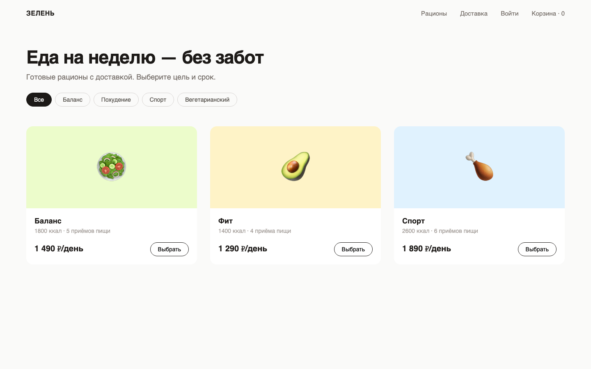
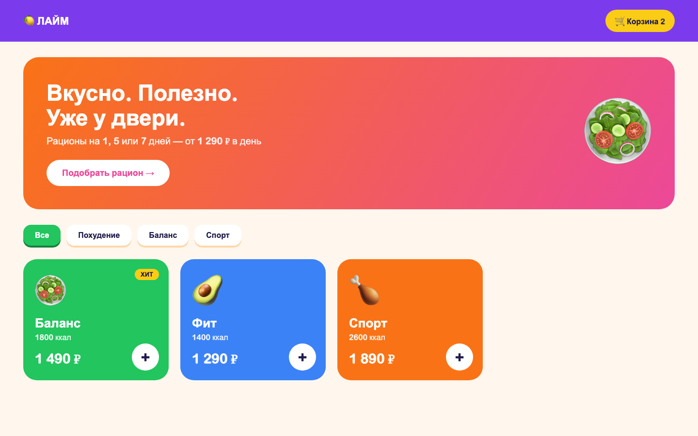
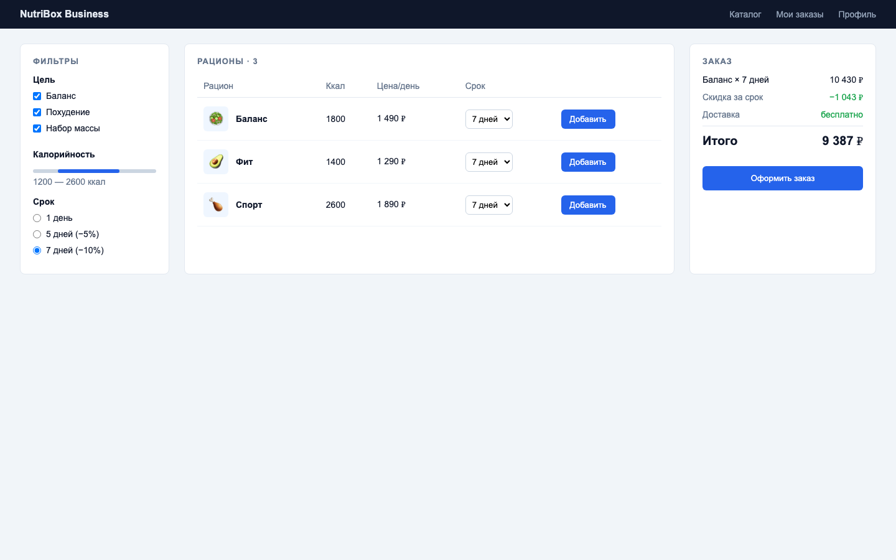

# UI-концепции

Концепции сгенерированы AI-агентом (Claude Code) по текстовому описанию — в роли Text-to-UI инструмента: агент получил описание экрана каталога и стиль и выдал готовую HTML-вёрстку. Исходники лежат рядом (`concept-*.html`) и открываются в любом браузере; скриншоты сняты headless-браузером в разрешении 1440×900.

**Общее описание для всех концепций:** главный экран каталога рационов — 3 рациона («Баланс», «Фит», «Спорт») с калорийностью, ценой за день, выбором/фильтром цели и доступом к корзине.

## Концепция 1 — Минимализм («Зелень»)

**Стиль и компоновка:** светлый тёплый фон, много воздуха, крупный заголовок, фильтр целей «таблетками», сетка из 3 карточек.

| Преимущества | Недостатки |
|---|---|
| спокойный «здоровый» образ, не отвлекает от еды | выглядит сдержанно, может казаться скучным |
| сетка карточек легко адаптируется: 3 → 2 → 1 колонка на мобильных | срок (1/5/7 дней) выбирается только на следующем шаге |
| минимум элементов — быстрая разработка на Tailwind | меньше «эмоционального» маркетинга |

## Концепция 2 — Яркий («Лайм»)

**Стиль и компоновка:** насыщенные цвета, градиентный баннер с призывом к действию, вкладки-кнопки, крупные цветные карточки с быстрой кнопкой «+».

| Преимущества | Недостатки |
|---|---|
| сильный акцент на призыве к действию, хорошо для промо | яркие цвета утомляют, сложнее поддерживать доступный контраст |
| быстрое добавление в корзину одной кнопкой «+» | у карточек мало места под информацию (состав, БЖУ) |
| запоминающийся бренд | баннер занимает половину экрана на мобильных |

## Концепция 3 — Корпоративный («NutriBox Business»)

**Стиль и компоновка:** строгая палитра, трёхколоночный макет: фильтры слева, таблица рационов в центре, сводка заказа справа.

| Преимущества | Недостатки |
|---|---|
| максимум информации и контроля, итог заказа всегда на виду | таблица и 3 колонки плохо адаптируются под мобильные |
| удобно для повторных заказов и B2B (офисное питание) | выглядит как CRM, а не как сервис еды |
| фильтры по калорийности и сроку сразу на экране | для ЦА 25–45 лет из B2C избыточно |

## Выбор: Концепция 1 — Минимализм

**Обоснование:**
1. **Mobile-first.** Основной сценарий ЦА — заказ с телефона; сетка карточек естественно складывается в одну колонку, тогда как таблица концепции 3 требует отдельной мобильной версии.
2. **Срок разработки MVP 3 месяца.** Минимум кастомных элементов — компоненты быстро собираются на Tailwind; в ДЗ1 уже сделана карточка в этом стиле (`MealCard`).
3. **Соответствие продукту.** Спокойный стиль поддерживает ощущение «здоровой еды» и не конкурирует с фото блюд.
4. **Из других концепций берём лучшее:** бейдж «Хит» и быстрое добавление из концепции 2, блок итога со скидкой за срок из концепции 3 — на экране корзины.
