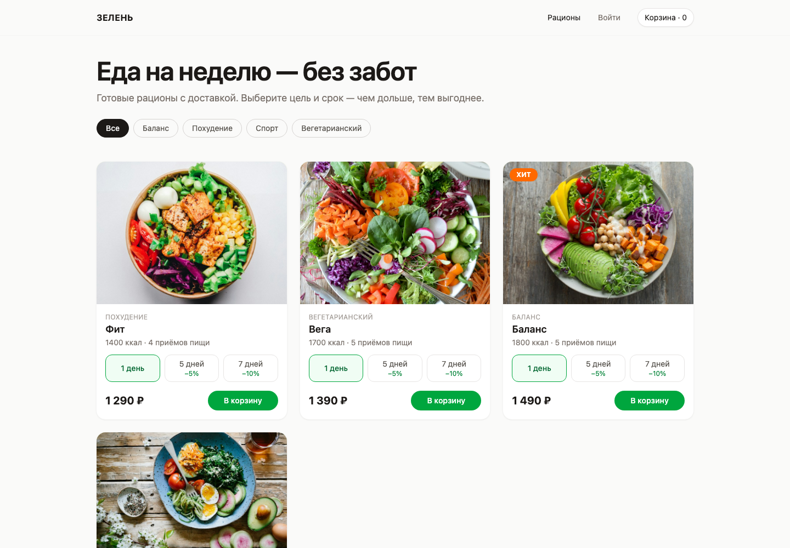
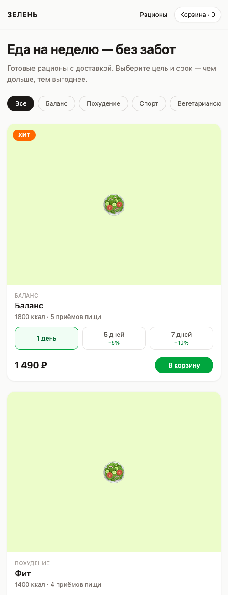
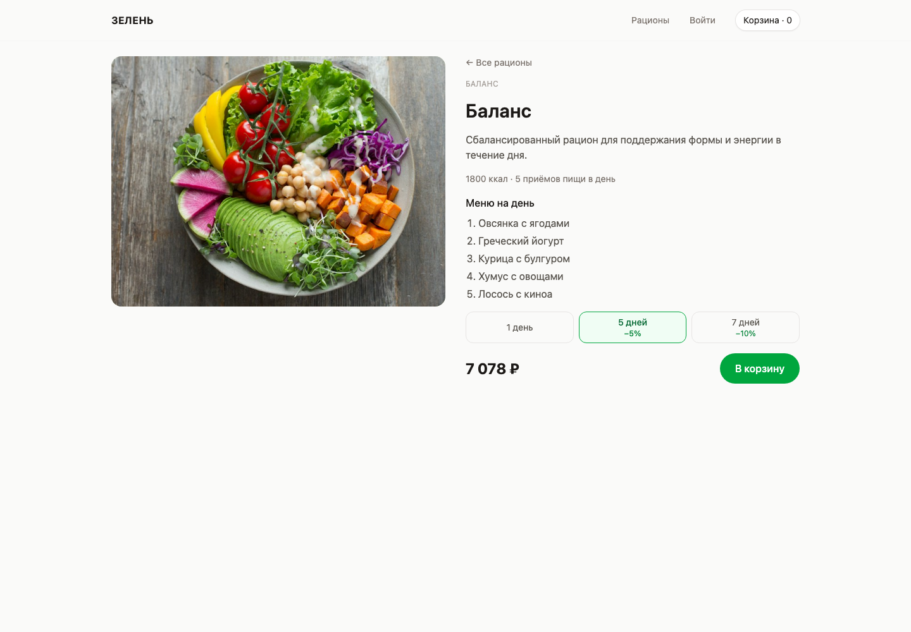

# ДЗ4. Разработка Frontend-приложения с AI-агентом

**Код:** [app/](../app/) · **README и запуск:** [app/README.md](../app/README.md) · **Демо:** https://alksndr9.github.io/mii-labs/

## 1. Техническое задание и стек
За основу взято ТЗ из ДЗ3 ([technical_specification.md](../hw3/technical_specification.md)) и выбранная UI-концепция «Минимализм».

| Слой | Выбор | Почему |
|---|---|---|
| Фреймворк | React 19 + TypeScript strict + Vite | стек из правил проекта (ДЗ2), быстрый dev-сервер с hot reload |
| UI | Tailwind CSS v4 | utility-классы, адаптивность через брейкпоинты `sm/md/lg` |
| Роутинг | React Router (HashRouter) | GitHub Pages не умеет SPA-fallback, хэш-роутинг работает без сервера |
| Тесты | Vitest + React Testing Library | нативная интеграция с Vite |
| Линтер | oxlint | входит в шаблон Vite, в 50–100 раз быстрее ESLint |

**Реализованные функции (из ТЗ):**
1. **Каталог рационов** с фильтром по цели — ФТ 4.2.
2. **Страница рациона**: меню на день, калорийность, выбор срока 1/5/7 дней с пересчётом цены — ФТ 4.3, 4.4.
3. **Корзина**: изменение количества, промокод, расчёт скидки за срок, порога бесплатной доставки и итога — ФТ 4.5, 4.9.
4. **Оформление заказа**: форма адреса и телефона с валидацией, дата первой доставки не ранее +2 дней — ФТ 4.7.

## 2. Инициализация проекта с агентом
Агент (Claude Code) создал проект и настроил окружение:
```bash
npm create vite@latest app -- --template react-ts
npm install react-router-dom @supabase/supabase-js
npm install -D tailwindcss @tailwindcss/vite vitest jsdom @testing-library/react @testing-library/user-event @testing-library/jest-dom
```
- `vite.config.ts`: плагины React и Tailwind, `base: '/mii-labs/'` под GitHub Pages, настройки Vitest (jsdom, setup-файл);
- `tsconfig.app.json`: включён `strict`, добавлены типы `vitest/globals`;
- **файл правил из ДЗ2** (`CLAUDE.md` в корне репозитория) подхватывается агентом автоматически — вся структура `src/features/*`, именованные экспорты, деньги в копейках и тесты рядом с кодом следуют из него.

## 3. Базовая структура
```
src/
├── App.tsx, app/Layout.tsx        # роутинг и каркас
├── features/catalog/              # api/ (mealsApi, mockMeals), components/ (MealCard, DurationPicker), pages/
├── features/cart/                 # lib/calculateOrderTotal + тесты, CartContext, promoCodes, pages/CartPage
├── features/checkout/             # lib/validateAddress + тесты, components/AddressForm, api/ordersApi, pages/
└── shared/                        # api/supabase, lib/(useAsync, formatMoney), ui/(StatusViews, MealImage), types/
```
**Переиспользование результатов ДЗ2:** модули `calculateOrderTotal` (результат Chain-of-Thought) и `AddressForm`/`validateAddress` (результат теста «с правилами») агент сгенерировал ещё в ДЗ2 — они перенесены в приложение без изменений вместе с тестами.

## 4. Компоненты и состояния
| Компонент | Loading | Error | Empty / Success |
|---|---|---|---|
| `CatalogPage` | спиннер «Загружаем рационы…» | сообщение + кнопка «Повторить» | «Рационов с такой целью пока нет» / сетка карточек |
| `MealPage` | спиннер | сообщение + «Повторить» | «Рацион не найден» / страница рациона |
| `CartPage` | — (локальные данные) | «Промокод не найден» | «Корзина пуста» / список и итог |
| `AddressForm` | «Сохраняем…», кнопка заблокирована | ошибки полей + ошибка сохранения | экран «Заказ оформлен» |

Состояния загрузки реализованы общим хуком `useAsync` (дискриминированное объединение `loading | error | success`), UI-состояния — общими компонентами `LoadingState`, `ErrorState`, `EmptyState`. Mock-данные: [mockMeals.ts](../app/src/features/catalog/api/mockMeals.ts), задержка 400 мс имитирует сеть.

## 5. Тестирование и отладка с AI

### Автотесты — 90 тестов, все проходят
| Файл | Тестов | Что проверяет |
|---|---|---|
| `calculateOrderTotal.test.ts` | 37 | скидки за срок, порог доставки, промокоды, ошибки данных |
| `validateAddress.test.ts` | 25 | валидация полей и нормализация телефона |
| `AddressForm.test.tsx` | 7 | ошибки при отправке, фокус на первой ошибке, ошибка сохранения |
| `CatalogPage.test.tsx` | 3 | загрузка → карточки; фильтр и пустое состояние; **ошибка сети → «Повторить»** |
| `CartPage.test.tsx` | 5 | пустая корзина; скидка 10% и бесплатная доставка; удаление; **неверный промокод**; **повреждённый localStorage** |
| `diet.test.ts` | 13 | type guard срока |

```
 Test Files  6 passed (6)
      Tests  90 passed (90)
```

### Найденные и исправленные баги
**Баг 1 — интерпретация ошибки из консоли.** После переноса тестов из ДЗ2 упали 6 тестов `AddressForm` с ошибкой `TestingLibraryElementError: Found multiple elements with the text of: /Улица/`. Агент по тексту ошибки определил причину: формы из предыдущих тестов оставались в DOM, потому что React Testing Library очищает DOM автоматически только при `globals: true` в Vitest. Исправление — одна строка в `vite.config.ts`; после этого 82/82 тестов прошли.

**Баг 2 — анализ скриншота (мультимодальность).** На скриншоте мобильной версии страницы рациона агент заметил иконку «битой» картинки вместо фото: у `MealPage` не было заглушки при ошибке загрузки изображения (в каталоге она была). Исправление — общий компонент `MealImage` с fallback 🥗, использован в карточке, на странице рациона и в корзине.

**Баг 3 — ложная тревога при проверке адаптивности.** На мобильном скриншоте шириной 390 px страница выглядела обрезанной справа. Агент проверил `window.innerWidth` в headless Chrome и выяснил, что минимальная ширина окна там 500 px — вёрстка не виновата. Подтвердили через iframe шириной 390 px: горизонтальной прокрутки нет.

## 6. Адаптивная вёрстка
Mobile-first: базовые стили для телефона, расширение через брейкпоинты Tailwind — `sm` (640 px): 2 колонки и крупный заголовок; `lg` (1024 px): 3 колонки, корзина и оформление в две колонки (список + итог). Фильтр целей прокручивается горизонтально, кнопки и цена в карточке переносятся (`flex-wrap`), шапка закреплена (`sticky`).

| Десктоп (1440 px) | Мобильная вёрстка (< 640 px) |
|---|---|
|  |  |
|  |  |

> На скриншотах вместо фото — заглушки: в момент съёмки CDN изображений (Unsplash) был недоступен, что заодно демонстрирует работу fallback из бага 2.

## 7. Оптимизация и рефакторинг
| Что было | Что сделано | Зачем |
|---|---|---|
| линтер: `set-state-in-effect` в `useAsync` | состояние `loading` выставляется в `retry`, а не в эффекте | убран лишний каскадный рендер |
| линтер: `only-export-components` в `CartContext.tsx` | контекст и хук `useCart` вынесены в `cartContextValue.ts` | работает Fast Refresh при разработке |
| дублирование логики картинки | общий `MealImage` | одна точка исправления (баг 2) |
| цена со скидкой в карточке считалась отдельно | карточка и корзина используют один `calculateOrderTotal` | цена в каталоге и корзине не может разойтись |
| данные корзины из `localStorage` без проверки | валидация каждой строки type guard'ом | повреждённые данные не роняют приложение (есть тест) |

**Использованные промпты** — шаблоны из [ДЗ2](../hw2/prompt_templates.md): «Генерация компонента» (страницы и `MealCard`), «Написание тестов» (`CatalogPage`, `CartPage`), «Исправление бага» (баги 1–2), «Рефакторинг» (раздел 7).

**Самые эффективные техники:**
1. файл правил — агент сразу пишет код в нужной структуре, с тестами и состояниями;
2. переиспользование результатов предыдущих промптов (CoT из ДЗ2) — сложная логика уже была спроектирована и покрыта тестами;
3. проверка через скриншоты — нашла баг, который не ловят юнит-тесты;
4. автоматические проверки после каждого шага (`tsc`, `oxlint`, `vitest`, `build`) — агент сам замечает и исправляет ошибки.

## 8. Выводы и рекомендации
- AI-агент с файлом правил за одну сессию собрал MVP из 4 функций с 90 тестами; ручные правки не потребовались, но **проверять результат обязательно** — 2 из 3 найденных проблем были видны только при запуске и на скриншотах.
- Сложную бизнес-логику стоит проектировать отдельно (CoT) до написания UI — тогда UI становится тонким слоем над проверенной функцией.
- Для деплоя на GitHub Pages SPA нужен HashRouter или 404-redirect — это стоит указывать агенту заранее.
