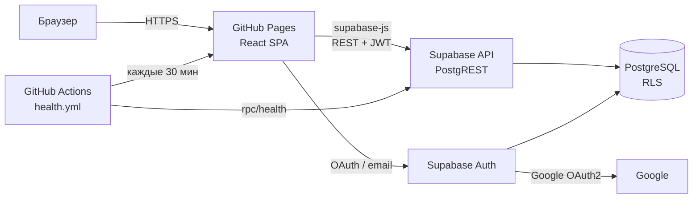
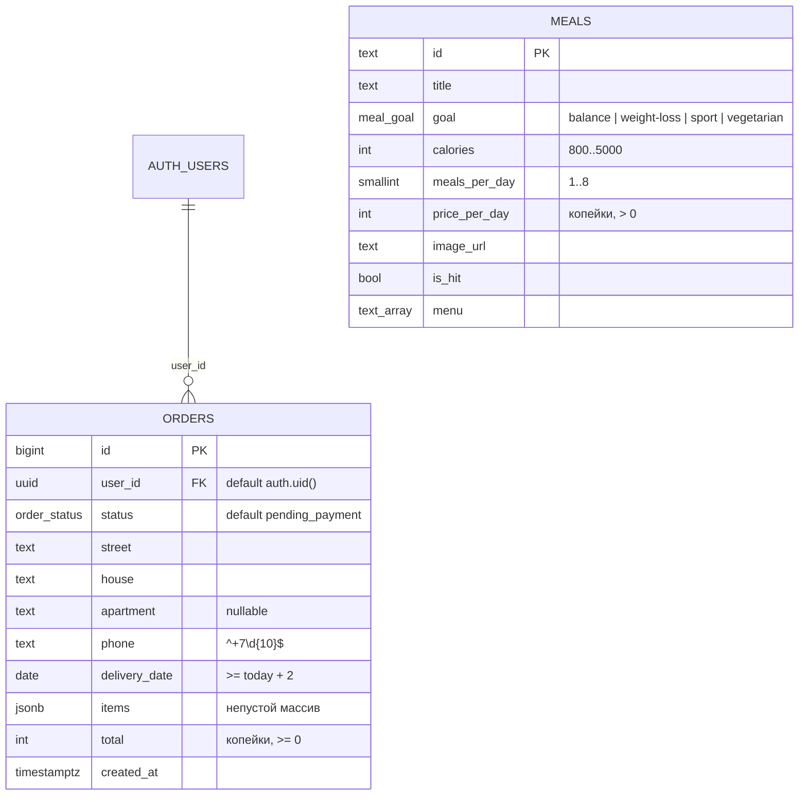

# ДЗ5. Backend и интеграция с Frontend

**Код бэкенда:** [supabase/](../supabase/) (миграции, сиды) · **Фронтенд:** [app/](../app/) · **Демо:** https://alksndr9.github.io/mii-labs/

## 1. Архитектура



| Компонент | Технология | Ответственность |
|---|---|---|
| Frontend | React SPA на GitHub Pages | UI, валидация форм, расчёт цены для отображения |
| API | Supabase PostgREST | автоматический REST по схеме БД, проверка JWT |
| Auth | Supabase Auth | регистрация и вход по email, Google OAuth2, выдача JWT |
| БД | PostgreSQL 15 | данные, ограничения (`check`), **Row Level Security** |

### Выбор инфраструктуры: Supabase (вариант A)
| Критерий | Supabase (BaaS) | Self-hosted (PostgreSQL в Docker на VPS) |
|---|---|---|
| Время до работающего API | минуты: REST генерируется по схеме | дни: свой сервер API, CORS, деплой |
| Аутентификация | готовая (email, OAuth, JWT) | писать самому или ставить отдельно |
| Безопасность доступа | RLS-политики в БД | middleware в своём коде |
| Стоимость для MVP | бесплатный тариф | VPS от ~500 ₽/мес + время на администрирование |
| Ограничения | серверы вне РФ (важно для 152-ФЗ в проде), vendor lock-in | полный контроль |

**Вывод:** для учебного MVP со сроком 3 месяца и одним разработчиком Supabase выигрывает по скорости и безопасности «из коробки». Требование 152-ФЗ о хранении ПДн в РФ зафиксировано в ТЗ (раздел 7.7) как условие продакшен-запуска.

## 2. Схема базы данных

Схема сгенерирована AI-агентом по требованиям из ТЗ (ДЗ3), затем проверена и скорректирована (см. раздел 7). Миграция: [`supabase/migrations/20261015000000_init.sql`](../supabase/migrations/20261015000000_init.sql), сиды: [`supabase/seed.sql`](../supabase/seed.sql).



**Ключевые решения:**
- деньги — `integer` в копейках (без ошибок округления `float`);
- инварианты продублированы в БД через `check` (формат телефона, дата доставки, непустой заказ) — даже прямой запрос в обход UI не создаст некорректный заказ;
- `user_id` заполняется на стороне БД из JWT (`default auth.uid()`), клиент его не передаёт;
- индекс `(user_id, created_at desc)` под запрос «Мои заказы».

## 3. Безопасность

### 3.1. Аутентификация
Supabase Auth: регистрация и вход по email + пароль (минимум 6 символов), вход через Google OAuth2 (ДЗ6). Сессия хранится supabase-js и автоматически обновляется (refresh token). Страницы оформления и «Мои заказы» закрыты компонентом `RequireAuth` — без входа идёт редирект на `/login` с возвратом обратно.

### 3.2. Row Level Security
RLS включён на всех таблицах; без явной политики доступ запрещён.

| Таблица | Операция | Кому | Условие |
|---|---|---|---|
| `meals` | SELECT | anon, authenticated | всем (каталог публичный) |
| `meals` | INSERT/UPDATE/DELETE | — | запрещено (только миграции / Studio) |
| `orders` | SELECT | authenticated | `user_id = auth.uid()` |
| `orders` | INSERT | authenticated | `user_id = auth.uid() and status = 'pending_payment'` |
| `orders` | UPDATE | authenticated | только свой заказ, только `pending_payment → cancelled`; колоночный `grant update (status)` — менять адрес и сумму нельзя |
| `orders` | DELETE | — | запрещено |

### 3.3. CORS
PostgREST Supabase отвечает с `Access-Control-Allow-Origin: *`, но доступ к данным определяется не origin, а **JWT + RLS**: анонимный ключ даёт только то, что разрешено политиками для роли `anon` (чтение каталога). Для Auth в настройках проекта (Authentication → URL Configuration) разрешены только адреса фронтенда: `https://alksndr9.github.io/mii-labs/` и `http://localhost:5173/mii-labs/` — редиректы OAuth на другие домены запрещены.

### 3.4. Секреты
| Секрет | Где хранится | В коде? |
|---|---|---|
| `VITE_SUPABASE_URL`, `VITE_SUPABASE_ANON_KEY` | `app/.env.local` (в `.gitignore`), GitHub Secrets для CI | нет, только `.env.example` |
| `service_role` ключ | только в панели Supabase | не используется во фронтенде |
| Google Client Secret | настройки провайдера в Supabase Auth | нет |

Анонимный ключ по дизайну Supabase публичный (он попадает в JS-бандл); защиту обеспечивает RLS.

## 4. API

Базовый URL: `https://<project>.supabase.co/rest/v1`. Заголовки: `apikey: <anon key>`, для авторизованных запросов — `Authorization: Bearer <access_token>`.

| Метод | Endpoint | Назначение | Доступ |
|---|---|---|---|
| GET | `/meals?select=*&order=price_per_day` | каталог рационов | все |
| GET | `/meals?id=eq.balance` | один рацион | все |
| POST | `/orders` | создать заказ (Create) | авторизованные |
| GET | `/orders?select=id,status,total&order=created_at.desc` | мои заказы (Read) | владелец |
| PATCH | `/orders?id=eq.{id}` `{"status":"cancelled"}` | отменить заказ (Update) | владелец, только `pending_payment` |
| POST | `/rpc/health` | health check | все |

### Примеры запросов
```bash
export SB=https://<project>.supabase.co ANON=<anon key>

# Каталог
curl "$SB/rest/v1/meals?select=id,title,price_per_day&order=price_per_day" -H "apikey: $ANON"

# Вход и получение токена
TOKEN=$(curl -s "$SB/auth/v1/token?grant_type=password" -H "apikey: $ANON" -H "Content-Type: application/json" \
  -d '{"email":"user@example.com","password":"secret123"}' | jq -r .access_token)

# Создать заказ
curl -X POST "$SB/rest/v1/orders" -H "apikey: $ANON" -H "Authorization: Bearer $TOKEN" \
  -H "Content-Type: application/json" -H "Prefer: return=representation" \
  -d '{"street":"ул. Мира","house":"12","phone":"+79001234567","delivery_date":"2026-10-20","items":[{"diet_id":"balance","days":7,"quantity":1}],"total":938700}'

# Отменить заказ
curl -X PATCH "$SB/rest/v1/orders?id=eq.1" -H "apikey: $ANON" -H "Authorization: Bearer $TOKEN" \
  -H "Content-Type: application/json" -d '{"status":"cancelled"}'

# Health check
curl -X POST "$SB/rest/v1/rpc/health" -H "apikey: $ANON"
```

### Ответы и ошибки
| Ситуация | HTTP / код PostgREST | Что видит пользователь (`toApiError`) |
|---|---|---|
| Истёк или неверный JWT | 401 / `PGRST301`, `PGRST303` | «Сессия истекла. Войдите в аккаунт ещё раз.» |
| Нарушение RLS (чужой заказ, аноним) | 401/403 / `42501` | «Нет доступа к этим данным.» |
| Нарушение `check` (телефон, дата) | 400 / `23514` | «Проверьте правильность введённых данных.» |
| Ошибка сервера | 5xx | «Сервис временно недоступен. Попробуйте через минуту.» |
| Нет сети | — | «Нет соединения с сервером. Проверьте интернет и повторите.» |

## 5. Интеграция Frontend ↔ Backend
- клиент: `@supabase/supabase-js` ([`shared/api/supabase.ts`](../app/src/shared/api/supabase.ts)); если переменные окружения не заданы — приложение работает на mock-данных (удобно для разработки фронтенда и тестов);
- слой API по фичам: `catalog/api/mealsApi.ts` (чтение каталога), `checkout/api/ordersApi.ts` (создание заказа), `orders/api/myOrdersApi.ts` (список и отмена); компоненты не обращаются к Supabase напрямую (правило из ДЗ2);
- загрузка с сервера — хук `useAsync` с состояниями loading / error / success и повтором; отправка — `AddressForm` с состоянием «Сохраняем…» и показом ошибки сервера.

## 6. Обработка ошибок и логирование
- Все ошибки Supabase проходят через `toApiError` ([`shared/api/apiError.ts`](../app/src/shared/api/apiError.ts)) — перевод кода в понятное сообщение + запись в лог (покрыто тестами).
- Логи — структурированный JSON ([`shared/lib/logger.ts`](../app/src/shared/lib/logger.ts)): `{"ts","level","event","context"}`, уровни `info / warning / error`. Пример:
  ```json
  {"ts":"2026-10-15T19:02:11.412Z","level":"warning","event":"api_error","context":{"operation":"createOrder","kind":"forbidden","status":403,"code":"42501","message":"new row violates row-level security policy for table \"orders\""}}
  ```
- Серверные логи — Supabase Dashboard → Logs (API, Postgres, Auth).

## 7. Развёртывание

### 7.1. Supabase
1. Создать проект на [supabase.com](https://supabase.com) (регион — EU Central).
2. **SQL Editor** → выполнить [`supabase/migrations/20261015000000_init.sql`](../supabase/migrations/20261015000000_init.sql), затем [`supabase/seed.sql`](../supabase/seed.sql).
   _Альтернатива через CLI:_ `npx supabase link --project-ref <ref> && npx supabase db push && npx supabase db seed`.
3. **Authentication → URL Configuration:** Site URL `https://alksndr9.github.io/mii-labs/`, Redirect URLs — он же и `http://localhost:5173/mii-labs/`.
4. **Project Settings → API:** скопировать `Project URL` и `anon public` ключ.

### 7.2. Frontend
```bash
cd app
cp .env.example .env.local   # вписать URL и anon key
npm install && npm run dev
```
Для продакшена: GitHub → Settings → Secrets and variables → Actions → секреты `VITE_SUPABASE_URL`, `VITE_SUPABASE_ANON_KEY` (используются при сборке в CI).

## 8. Разработка с AI
| Задача | Как использовался AI |
|---|---|
| Проектирование БД | по ТЗ и типам фронтенда агент сгенерировал SQL-схему; при проверке добавлены `check`-ограничения, enum статусов из ТЗ (раздел 7.4), индекс под «Мои заказы» |
| RLS | агент предложил политики; при ревью найдена дыра: политика UPDATE позволяла владельцу менять **сумму** заказа — закрыто колоночным `grant update (status)` |
| Обработка ошибок | агент составил таблицу кодов PostgREST → сообщения пользователю и тесты на каждый тип (401, 403, 400, 500, сеть) |
| Логирование | структурированный JSON-логгер, пригодный для анализа AI (ДЗ6) |
