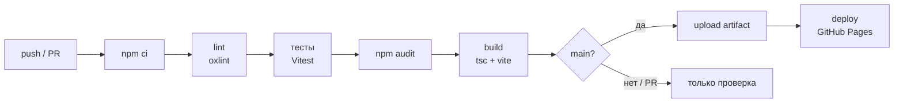
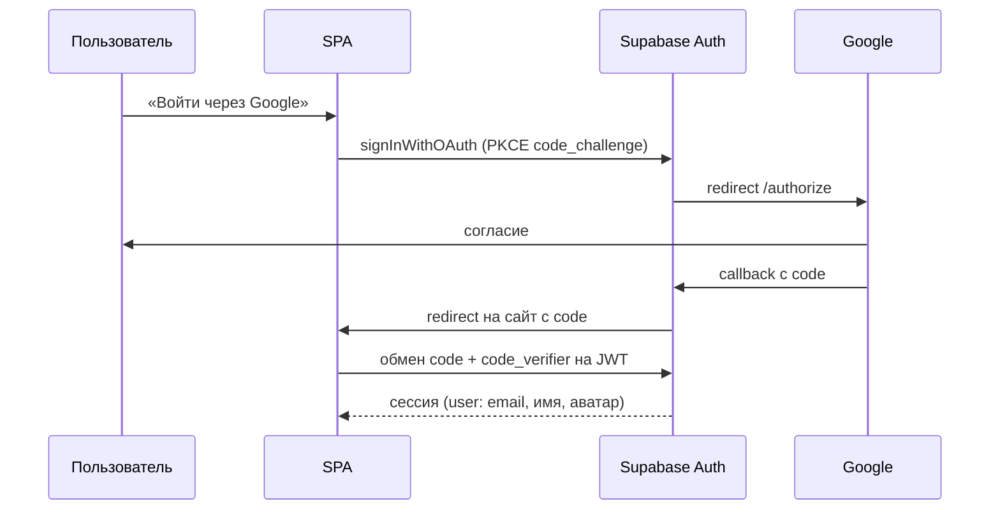

# ДЗ6. CI/CD и интеграция сервисов

**Демо:** https://alksndr9.github.io/mii-labs/ · **Пайплайн:** [Actions](https://github.com/Alksndr9/mii-labs/actions) · **Аудит безопасности:** [security_audit.md](security_audit.md)

| Шаг | Статус | Где |
|---|---|---|
| 1. CI/CD | ✅ | [.github/workflows/ci.yml](../.github/workflows/ci.yml) |
| 2. Аудит безопасности | ✅ 16 находок, 13 исправлено, 3 приняты | [security_audit.md](security_audit.md) |
| 3. OAuth2 (Google) | ✅ подключено и проверено на демо | `features/auth` |
| 4. Аналитика (Google Analytics 4) | ✅ код и события; Measurement ID — переменная CI | `shared/lib/analytics.ts` |
| 5. Платежи | ⏭ опционально, не делалось (схема в рекомендациях аудита) | — |
| 6. Мониторинг, health check, алерты | ✅ | [.github/workflows/health.yml](../.github/workflows/health.yml), RPC `health` |
| 7. Логирование + AI-анализ логов | ✅ | `shared/lib/logger.ts`, [раздел 6](#6-логирование-и-ai-анализ-логов) |
| 8. Тестирование и оптимизация | ✅ | раздел 7 |

## 1. CI/CD



- **Платформа:** GitHub Actions, базовый пайплайн сгенерирован AI-агентом и доработан (кэш npm, `concurrency`, минимальные `permissions`).
- **Этапы:** установка зависимостей → проверка качества кода (`oxlint`) → 96 автотестов → аудит зависимостей (high блокирует, moderate — отчёт) → проверка типов и сборка → деплой.
- **Автодеплой:** при пуше в `main` собранный `app/dist` публикуется на GitHub Pages (`actions/deploy-pages`). Pull request'ы проходят только проверки, без деплоя.
- **Секреты сборки:** `VITE_SUPABASE_URL`, `VITE_SUPABASE_ANON_KEY` — GitHub Secrets; `VITE_GA_MEASUREMENT_ID` — GitHub Variables. Если секретов нет, CI выдаёт предупреждение, а сайт показывает баннер «Демо-режим».

<details><summary>Конфигурация пайплайна (фрагмент)</summary>

```yaml
jobs:
  check:
    steps:
      - run: npm ci
      - run: npm run lint
      - run: npm test
      - run: npm audit --omit=dev --audit-level=high
      - run: npm run build
        env:
          VITE_SUPABASE_URL: ${{ secrets.VITE_SUPABASE_URL }}
          VITE_SUPABASE_ANON_KEY: ${{ secrets.VITE_SUPABASE_ANON_KEY }}
          VITE_GA_MEASUREMENT_ID: ${{ vars.VITE_GA_MEASUREMENT_ID }}
      - uses: actions/upload-pages-artifact@v3
  deploy:
    needs: check
    if: github.ref == 'refs/heads/main'
    steps:
      - uses: actions/deploy-pages@v4
```
</details>

## 2. Аудит безопасности
Кратко: `npm audit` — 0 уязвимостей; AI-аудит по OWASP Top 10 нашёл 16 проблем, главная — **сумма заказа считалась в браузере** (исправлено переносом расчёта в серверную функцию `create_order`). Подробности, таблица исправлений и рекомендации — [security_audit.md](security_audit.md).

## 3. OAuth2: вход через Google

**Как устроено:** Supabase Auth выступает OAuth-клиентом Google. Фронтенд вызывает `supabase.auth.signInWithOAuth({ provider: 'google' })` с **PKCE**; после согласия Google возвращает пользователя на сайт с одноразовым `code`, supabase-js обменивает его на сессию (JWT). Секрет клиента хранится только в Supabase.



**Инструкция по настройке:**
1. [Google Cloud Console](https://console.cloud.google.com/) → APIs & Services → **OAuth consent screen**: тип External, имя «Зелень», email поддержки.
2. **Credentials → Create credentials → OAuth client ID**, тип Web application.
   - Authorized JavaScript origins: `https://alksndr9.github.io`
   - Authorized redirect URIs: `https://<project-ref>.supabase.co/auth/v1/callback`
3. Скопировать **Client ID** и **Client Secret** → Supabase → Authentication → Providers → **Google** → включить, вставить.
4. Supabase → Authentication → URL Configuration: Site URL и Redirect URLs — адреса фронтенда (см. [ДЗ5, раздел 7.1](../hw5/backend_documentation.md#71-supabase)).

**Проверка:**
| Сценарий | Ожидаемо |
|---|---|
| Успешный вход | редирект обратно, в шапке появляются «Заказы» и «Выйти», в Supabase → Users пользователь с provider `google` |
| Отмена на экране Google | возврат на сайт без сессии, кнопка «Войти» остаётся |
| Ошибка провайдера (выключен в Supabase) | сообщение «Не удалось выполнить вход. Попробуйте ещё раз.», событие `auth_error` в логе |
| Данные пользователя | `user.email`, `user.user_metadata.full_name`, `avatar_url` |

## 4. Аналитика: Google Analytics 4

**Интеграция:** [`shared/lib/analytics.ts`](../app/src/shared/lib/analytics.ts) — асинхронная загрузка `gtag.js`, инициализация из `VITE_GA_MEASUREMENT_ID` (без ID аналитика выключена — локально и в тестах). HashRouter не перезагружает страницу, поэтому автоматический `page_view` отключён и просмотры отправляются вручную. Персональные данные (email, телефон, адрес) в события не передаются (аудит F-06).

**Почему не Яндекс.Метрика:** изначально интеграция была сделана под Метрику, но сервис оказался недоступен при регистрации счётчика, поэтому аналитика переведена на GA4 — события и точки вызова в коде не изменились, заменён только модуль отправки.

**События,** подобраны с AI под воронку заказа (`add_to_cart`, `begin_checkout`, `sign_up` — рекомендованные события GA4):
| Цель | Когда | Параметры | Зачем |
|---|---|---|---|
| `add_to_cart` | добавление рациона | `dietId`, `days` | какие рационы и сроки популярны |
| `promo_applied` | применён промокод | `code` | эффективность промо |
| `begin_checkout` | открыт экран оформления | — | конверсия корзина → оформление |
| `order_created` | заказ создан | `total` | конверсия в заказ, средний чек |
| `sign_up` | регистрация | — | конверсия в аккаунт |
| `app_error` | любой лог уровня `error` | `event` | на каком шаге воронки ломается приложение |

**Настройка:** analytics.google.com → Admin → создать ресурс → веб-поток для `https://alksndr9.github.io/mii-labs/` → Measurement ID (`G-…`) записать в GitHub → Settings → Variables → `VITE_GA_MEASUREMENT_ID`. Для отчёта по воронке события `order_created` и `sign_up` отмечаются как ключевые (Admin → Events → Mark as key event).

**Проверка отправки:** GA → Reports → Realtime (или Admin → DebugView) — события появляются в течение минуты; каждое событие также дублируется в структурированный лог (`analytics_goal`).

## 5. Мониторинг и health check
| Что | Как |
|---|---|
| Health check БД | RPC `health()` → `{"status":"ok","db":true,"meals":4,"time":"…"}`; вызов: `POST /rest/v1/rpc/health` |
| Проверка доступности | workflow [`health.yml`](../.github/workflows/health.yml) **каждые 30 минут**: фронтенд (HTTP 200) и бэкенд (`status: ok`) |
| Алерты | падение workflow → GitHub автоматически отправляет письмо владельцу репозитория (Settings → Notifications → Actions) |
| Встроенные средства | Supabase Dashboard → Reports (запросы, ошибки), Logs (API, Postgres, Auth); GitHub Pages — статус деплоя в Actions |

Внешний сервис (UptimeRobot) не обязателен: GitHub Actions по расписанию покрывает проверку и алерты бесплатно, а история прогонов служит журналом аптайма.

## 6. Логирование и AI-анализ логов

**Формат:** JSON-строка на событие, уровни `info / warning / error`, псевдонимный `sessionId` для связи событий одной сессии, без ПДн:
```json
{"ts":"2026-10-15T19:01:05.007Z","sessionId":"3f9a1c2e","level":"warning","event":"api_error","context":{"operation":"createOrder","kind":"forbidden","status":403,"code":"42501"}}
```
**Хранение:** клиентские логи — консоль браузера + ошибки в GA (событие `app_error`); серверные — Supabase Logs (централизованно, с поиском).

### Промпт для анализа логов
```markdown
**Role:** Ты — SRE-инженер.
**Task:** Проанализируй структурированные JSON-логи фронтенда сервиса заказа еды (React + Supabase).
**Context:** формат {ts, sessionId, level, event, context}; коды — PostgREST (PGRST*), Postgres (SQLSTATE), Supabase Auth.
**Format:** 1) таблица инцидентов, сгруппированных по причине; 2) первопричина по коду и статусу;
3) влияние на пользователя и воронку; 4) шаги диагностики (какие логи Supabase, какие запросы);
5) что улучшить в логировании.
```

### Тест на типичных ошибках
На вход — 15 строк лога с 5 типовыми проблемами ([raw/sample-logs.jsonl](raw/sample-logs.jsonl)), ответ — [raw/ai-log-analysis.md](raw/ai-log-analysis.md):

| Инцидент в логах | Что определил AI | Верно? |
|---|---|---|
| 2× `createOrder` 400 / `23514` | нарушение CHECK-ограничения, клиент не провалидировал данные | ✅ |
| 2× `createOrder` 403 / `42501` | запрет RLS или отсутствие GRANT; заметил связь с миграцией прав в тот же день | ✅ (именно это меняла миграция аудита) |
| `fetchMyOrders` 401 / `PGRST303` | невалидный/истёкший JWT, связал с предыдущим инцидентом | ✅ |
| network ×2 → 503 / `PGRST002` | PostgREST потерял соединение с Postgres, каталог недоступен ~15 с — критично | ✅ |
| 2× `invalid_credentials` → 429 | неверный пароль, затем rate limit; возможный перебор | ✅ |

**Применённая рекомендация AI:** в логах не было идентификатора сессии, поэтому нельзя доказать, что ошибки — одна сессия пользователя. Добавлен псевдонимный `sessionId` (8 символов UUID вкладки, без ПДн).

## 7. Тестирование интеграций и оптимизация

| Проверка | Результат |
|---|---|
| CI на тестовом коммите | lint → 96 тестов → audit → build → deploy |
| Обработка ошибок API (401/403/400/500/сеть) | 6 автотестов `apiError.test.ts` |
| Сборка с CSP в браузере | каталог рендерится, внешние скрипты ограничены |
| OAuth (Google) | вход на демо-сайте работает, провайдер включён в Supabase |
| Бэкенд в проде | сборка CI с секретами Supabase, `health` → `ok` |

**Оптимизация (предложения AI → применено):**
| Предложение | Эффект |
|---|---|
| Ленивая загрузка страниц входа, оформления и заказов (`React.lazy`) | эти страницы вынесены в отдельные чанки (1,9 + 2,8 + 6,3 kB), не грузятся на первом экране |
| `loading="lazy"` для фото рационов | картинки ниже первого экрана не блокируют загрузку |
| Цена в каталоге и корзине — одна чистая функция без повторных запросов | нет лишних запросов к API при смене срока |
| Асинхронная загрузка `gtag.js` | аналитика не блокирует отрисовку |

## 8. Использование AI
| Задача | Роль AI |
|---|---|
| CI/CD | сгенерировал пайплайн и health-workflow, предложил `concurrency` и минимальные `permissions` |
| Аудит безопасности | нашёл 16 проблем по OWASP, включая подмену суммы заказа; предложил исправления |
| Аналитика | подобрал цели под воронку заказа |
| Логи | разобрал инциденты по кодам ошибок и предложил улучшение формата |
| Оптимизация | предложил code splitting и ленивую загрузку |
